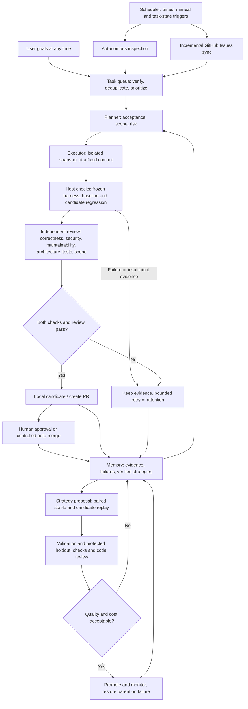

# Adaptive RSI

[简体中文](README.md) | **English**

A local autonomous improvement runtime for Codex: **code inspection, user goals, and GitHub Issues → task queue → planning → isolated implementation → independent verification → local candidate / PR → memory and the next round**.

Includes a plugin entry point, persistent scheduler, SQLite state and session budgets, protected evaluator, strategy candidate archive, and a Chinese/English dashboard. Requires Python 3.9+; the runtime has no third-party Python dependencies.

## Workflow



The scheduler waits between scans instead of continuously invoking models; queued tasks proceed when ready. Automatic PR creation and merging are separate settings. Local verification does not establish that a change is merged or that deployment works. Strategy evolution runs through a separate protected experiment loop and cannot rewrite permissions or acceptance rules.

## Code quality gates

Implementation and review use separate sessions with different permissions. Review can use a different provider. All six review areas require reasoned assessments; actionable findings include severity, file, line, impact and a suggested change. Reports appear in task details.

The default threshold blocks **medium and above**, configurable to high or low. Critical and high findings always block. A failed area or insufficient evidence also blocks delivery. A reported pass cannot override a blocking finding: the host enforces the outcome. Failed reports enter subsequent retry context.

Maintainability review covers duplication, unnecessary abstraction, complex branches, coupling, naming and project conventions. It targets introduced issues without demanding unrelated refactoring. Add project lint, type, complexity or dependency checks to `checks` for deterministic gates alongside tests; the runtime does not automatically impose a static-analysis tool suite. Model review can miss problems and cannot guarantee code quality.

Both ordinary tasks and strategy replay use these gates. Paired experiments review both variants and count review costs symmetrically. The default experiment session cap is now 40; the project daily cap remains 30. Check both before a formal experiment. Exhaustion stops work without silently increasing limits.

## Non-GPT models and providers

Codex CLI still supplies execution tools, while each role can choose its own model and provider, including non-GPT models:

| Route | Configuration | Requirements |
| --- | --- | --- |
| OpenAI / Codex | `provider: "openai"`, default | Existing Codex authentication |
| Local Ollama | `provider: "ollama"` | Codex OSS mode, available local model and tool use |
| Local LM Studio | `provider: "lmstudio"` | Same; start the service first |
| Third-party gateway / self-hosted service | Register a provider, then select its ID | Responses streaming protocol, tools and structured output |

Native Anthropic Messages, Gemini GenerateContent and Chat-Completions-only endpoints are **not directly connected**; they need a compatible gateway. A model name alone does not establish support for specific Claude, Gemini, DeepSeek or Qwen versions. The first real invocation establishes compatibility; no silent substitution occurs.

In **Settings → Models & reasoning effort**, add providers, edit endpoints, choose each role's provider/model, and set the review threshold. Prefer `default` for local or third-party models to omit the explicit GPT reasoning-effort parameter. Explicit effort settings must be supported by the service.

Example configuration (use the model ID offered by your service):

```json
{
  "providers": [{"id":"gateway","name":"My model gateway","base_url":"https://models.example.com/v1","env_key":"RSI_MODEL_API_KEY"}],
  "models": {
    "implementation": {"provider":"gateway","model":"your-coder-model","effort":"default"},
    "review": {"provider":"openai","model":"gpt-6.1-sol","effort":"high"}
  }
}
```

`env_key` is an **environment variable name**, never a key value. Supply it through the runtime service's launch environment; restart an existing service to inherit changes. Provider settings, database fields and command arguments do not store key values. Model workers inherit the launch environment; project checks use isolated environments. Do not paste keys into project files or the dashboard. Remote endpoints require HTTPS; loopback permits HTTP. An unauthenticated local service may use an empty `env_key`. Provider lists replace the entire list and IDs must be unique.

Explicit fallback routes can cross providers, for example:

```json
{"models":{"implementation":{"fallback":{"provider":"ollama","model":"your-local-coder","effort":"default"}}}}
```

Only provider/model availability or rate-limit errors trigger fallback. Failed checks and reviews cannot be bypassed by switching models. Each session records actual provider, model, effort and usage. Changing models, endpoints or review rules invalidates previous strategy compatibility evidence and requires revalidation.

Configuration reference: [official Codex advanced configuration](https://developers.openai.com/codex/config-advanced/). Parameter routing and deterministic substitutes have been tested; live third-party/local model execution has not.

## Quick start

On macOS, double-click `启动 Adaptive RSI.command`, or run from this directory:

```sh
python3 scripts/start.py
```

The launcher reuses an existing service. Closing the browser does not stop scheduling. Work pauses during sleep; missed triggers are coalesced on resume. To stop the service, send SIGTERM to its PID in `server.json`, or run in the foreground and press Ctrl+C:

```sh
python3 -m adaptive_rsi serve --open
python3 scripts/rsi doctor
```

In **Add project**, enter the root of a Git repository with an existing commit. Review settings, then enable it. Projects start paused; registering one does not invoke a model. No initial goal is required.

The dashboard defaults to Chinese. Select **English** in the top bar; the browser remembers the choice. Task content, model output, raw logs, and evidence retain their original language. CLI commands and configuration keys remain English.

State defaults to `~/.local/share/adaptive-rsi`. Override it with `ADAPTIVE_RSI_HOME` or `--state-dir`. Keep state outside managed project trees. The dashboard listens only on `127.0.0.1`. Its login URL contains a local session token: do not share it. Reopen with `python3 scripts/rsi open`.

## The improvement loop

- **Scheduling:** light inspection every 120 minutes, incremental Issues sync every 60 minutes, and deep inspection every 4320 minutes. Configure time zone and working hours. Ready tasks continue without waiting for the next inspection. Light inspection skips model calls when the committed snapshot is unchanged; deep inspection rotates modules. Resume does not replay every missed trigger.
- **Models:** analysis, planning, review, and improvement proposals use `gpt-6.1-sol / high`; implementation uses `gpt-6-luna / max`. CLI arguments enforce these routes. Fallbacks must be explicitly configured; failures are recorded. There is no paid availability probe: actual availability is established by the first invocation.
- **Task sources:** discovered tasks require verifiable references to existing code. User goals can enter at any time. Issues support label filters, update cursors, deduplication, closed-Issue checks, and existing PR context. Issue text does not grant permissions.
- **Isolation and verification:** each run uses clones of a fixed Git commit and leaves the user's worktree untouched. Implementation and review use separate sessions. The host freezes check commands and reruns baseline and candidate checks independently. Original tests and build entry points are restored from the baseline and protected against writes during checks. Model claims do not establish success. Missing checks, zero tests, or insufficient evidence block delivery.
- **State and budgets:** service/project locks, atomic task claims, frozen configuration, reserved Codex sessions, daily/per-run limits, run and command timeouts, output limits, bounded backoff retries, pause/cancel, and fresh-snapshot recovery after crashes. Actual tokens and elapsed time are recorded; dollar costs are not invented. Limits count CLI sessions, each of which can include several reasoning turns, rather than individual API requests or a strict monetary budget.
- **Delivery:** keep patches and verification evidence locally by default. Approve PR delivery per run or explicitly enable automatic PR creation. High-risk plans wait locally. Auto-merge requires a separate setting and uses GitHub auto-merge with commit matching. The runtime does not rewrite the user's repository or discard uncommitted work.
- **Strategy evolution:** execution strategies, meta-strategies, and adapter guidance evolve as retrieved instructions. Candidates cannot change the controller, permissions, budgets, or evaluator. Validation and holdout tasks compare stable and candidate strategies in paired runs. Promotion requires improved quality, no observed regression, and acceptable time/token costs. Early monitored failures restore the previous stable strategy and invalidate its learned skills. Observations, verified skills, and failed candidates are stored separately.

## Environment and boundaries

Full **model-worker execution currently requires macOS Seatbelt**, layered with Codex's workspace sandbox. Deterministic checks support Seatbelt or Docker. Linux and other POSIX hosts can serve the dashboard and detect code, but model workers are deliberately blocked. Windows hosting is not supported. Docker checks require a running daemon and a pre-pulled trusted image; containers have no network or host credentials and have CPU, memory, and process limits. The runtime does not automatically pull images or install dependencies.

Adapters recognize Java/Kotlin (Maven, Gradle), JavaScript/TypeScript (npm, pnpm, Yarn), Python, Go, Rust, C/C++, .NET, PHP, Ruby, Swift/Objective-C, and Dart/Flutter, and analyze SQL, Shell, PowerShell, HTML/CSS, Docker, and CI configuration. Capability states distinguish unverified, analysis-only, and environment-blocked projects. Xcode, Make, and other project-specific builds need explicit commands. Uncached dependencies require environment preparation. Detection does not certify all builds for a language.

Acceptance relies on fixed project checks. Configure appropriate checks where missing; model review cannot replace tests. Frozen tests, separate sessions, and OS sandboxes reduce tampering risk but are not a formal security proof against arbitrary malicious code. Codex CLI handles model authentication and networking. Code context goes to the selected provider under that provider's data policy. The runtime does not independently publish local dashboard data, logs, or memory.

Long-term recursive improvement requires real tasks and sustained experiments; this release does not claim to have demonstrated it. Without protected evaluation cases, candidates can be proposed and archived but **cannot be automatically promoted**. Scheduling is periodic or manual. There is no OS startup service or native Codex settings page.

## Configuration and CLI

Precedence: **task overrides > project overrides > global defaults**. Active runs retain their initial configuration. The dashboard exposes common settings; advanced JSON and the CLI cover the full configuration.

```sh
python3 scripts/rsi add /path/to/repository
python3 scripts/rsi status
python3 scripts/rsi resume PROJECT_ID
python3 scripts/rsi goal PROJECT_ID 'Fix pagination boundaries and add regression checks'
python3 scripts/rsi inspect PROJECT_ID --deep
python3 scripts/rsi issues PROJECT_ID
python3 scripts/rsi pause PROJECT_ID
python3 scripts/rsi config --project PROJECT_ID --json '{"schedule":{"light_minutes":240},"limits":{"daily_calls":20}}'
python3 scripts/rsi goal PROJECT_ID 'Improve error handling' --overrides '{"limits":{"run_seconds":1200}}'
python3 scripts/rsi deliver RUN_ID
python3 scripts/rsi retry TASK_ID
python3 scripts/rsi rollback CANDIDATE_ID
```

Fixed checks use argument arrays, not shell concatenation:

```json
{"checks":[{"name":"unit regression","cwd":".","argv":["python3","-m","unittest","discover","-s","tests","-v"]}]}
```

Prepare dependencies in a trusted container image or explicitly select untracked in-project dependency directories as snapshot sources. Implementation and verification get separate copies; verification restores the same frozen dependencies without changing the original directory:

```json
{"environment":{"seed_paths":["node_modules"],"max_seed_mb":1024,"setup":[]}}
```

`setup` accepts offline preparation commands in the same format as `checks`. External symlinks, missing dependencies, or failed preparation block execution. A pnpm directory linked to a global store or a virtual environment pointing outside the project may require a self-contained image. The runtime does not expose the entire home directory for compatibility.

## Independent evaluation cases

Import real historical fixes or synthetic defects confined to evaluation snapshots. Example manifest:

```json
{
  "family": "pagination-empty-last-page",
  "split": "holdout",
  "source": "real",
  "repository": "/path/to/evaluation-fixture",
  "base": "COMMIT_SHA",
  "task": "Fix total counts and page calculations for an empty last page.",
  "checks": [{"name":"acceptance","cwd":".","argv":["python3","-m","unittest","discover","-s","tests","-v"]}],
  "overlay": "/path/to/protected-tests"
}
```

```sh
python3 scripts/rsi import-case PROJECT_ID case.json
python3 scripts/rsi evolve PROJECT_ID
```

Splits are `development`, `validation`, and `holdout`. A family or identical task snapshot cannot span splits; curators must label near-duplicate defect families correctly. Defaults require at least three families in both validation and holdout, with at most three exposures per case. The controller stores overlays and injects them into test directories only during independent evaluation, without giving them to candidates. Synthetic defects stay out of the real project queue and are not presented as business evidence.

## Codex plugin

`plugin.json` is an Agent Plugins 1.0 manifest. `.agents/plugins/marketplace.json` provides a local catalog entry, and `skills/` contains the skills. Add this project through a Codex plugin catalog supporting local marketplaces, then run setup. Installation and reload interfaces vary by client; the runtime does not alter your personal plugin catalog. The launcher also works without plugin installation.

## Development and validation

```sh
python3 -m unittest discover -v
node --check adaptive_rsi/web/app.js
node --check adaptive_rsi/web/i18n.js
```

Tests substitute the model interface while running real Git snapshots, SQLite concurrency, macOS sandbox checks, and regression checks. They do not consume model sessions or write to GitHub. Browser checks cover desktop/mobile layout and settings persistence. Live model authorization, long-running operation, and remote PR integration require a real project.

See [the validation report](VALIDATION.en.md) and [contribution guide](CONTRIBUTING.en.md).
