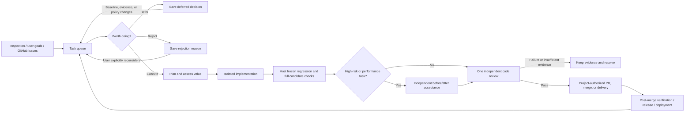

# Adaptive RSI

[简体中文](README.md) | **English**

Let AI inspect, fix, and improve your software projects continuously inside isolated workspaces.

Adaptive RSI turns project inspections, user goals, and GitHub Issues into maintenance tasks that must pass value assessment. Changes go through planning, isolated implementation, host checks, and code review before a project's own authorization allows a PR, merge, or delivery. Independent acceptance is reserved for high-risk and performance work.

[](https://github.com/Haoog/Adaptive-RSI/releases/latest)
[](pyproject.toml)
[](LICENSE)

[Download desktop](https://github.com/Haoog/Adaptive-RSI/releases/latest) · [Quick start](#quick-start) · [Documentation](#documentation) · [Boundaries](#safety-and-boundaries)

[Mobile installation and workflow guide](EXPERIENCE.en.md)

## Why Adaptive RSI

Autonomous coding tools can treat every suggestion as work and deliver changes with weak evidence. Adaptive RSI adds four constraints around implementation:

- Decide whether a problem is real, duplicated, and worth solving.
- Modify a fixed Git snapshot instead of the user's worktree.
- Evaluate behavior, configuration, and UI changes with isolated new regression tests that fail on the baseline and pass on the candidate, frozen regression checks, and code review; unsupported runners, high-risk, and performance tasks use independent acceptance.
- Create PRs, merge, release, or deploy only after project-level authorization.

Project inspection and Issue sync default to hourly. Both can be customized, paused, or inherited from shared settings. There are no call-count, run-duration, or finding quotas; tokens and available cost estimates are recorded for usage reporting.

## Workflow



Models, tasks, memory, usage, and delivery authorization remain separate per project. Pausing a project or revoking authorization blocks subsequent operations that have not yet been issued.

## Quick Start

### Desktop app (recommended)

1. Download the macOS ARM64 DMG from the [latest official release](https://github.com/Haoog/Adaptive-RSI/releases/latest).
2. Open the app, then add a GitHub repository or local Git project.
3. Connect a model and choose models for planning, implementation, and review.
4. Click **Start** for the project.

Custom model IDs allow up to 256 characters. Display names are optional and default to the full ID. Custom display names allow up to 160 characters and survive catalog refreshes; names supplied by the service continue to follow catalog updates.

Closing the window hides the app in the menu bar and active tasks continue. Choosing **Quit** from the menu bar stops the service started by the app. The current DMG uses a temporary signature and is not Apple-notarized.

### Run from source

Requires Python 3.9+ and Git; GitHub import and delivery also require authenticated `gh`:

```sh
python3 scripts/start.py
python3 scripts/rsi doctor
```

The launcher reuses an existing service. Task details offer paginated dependency selection; unsaved queue settings survive language changes and requirement supplements. Edits made while settings are saving survive project switches; usage searches invalidate old requests so late responses cannot replace newer queries. The dashboard persistently shows save status: saving scan timing reschedules scans, model assignments are saved separately for new tasks, active tasks retain their configuration, and delivery permissions are rechecked before execution. No restart is required. Edit fixed checks as structured fields and read check results and mobile approval summaries with expandable original evidence. Unconfirmed goals can restore their original text and reuse their request IDs. Pending-approval counts in Data and diagnostics exclude approved, delivering and cancelled candidates, and a failed restore leaves no half-created directory that blocks retry. See [workflow and mobile use](EXPERIENCE.en.md) for recovery controls and evidence boundaries after database restoration, and [server deployment](SERVER.en.md) for Linux and systemd setup.

## Core Capabilities

- **Continuous discovery:** hourly checks for bugs, feature gaps, performance, usability, and maintenance work, with rotating code modules. Sync GitHub Issues incrementally or add a goal at any time.
- **Value gate:** assess current evidence, duplicates, expected benefit, cost, and the impact of doing nothing before implementation.
- **Isolation and verification:** implementation and review use separate contexts. The host runs new behavior tests in isolation on the baseline and candidate, then runs frozen regression and full-candidate checks. Unsupported runners, high-risk, and performance tasks use independent acceptance; model claims do not establish success.
- **Code review:** check correctness, security, maintainability, architecture, tests, and scope. Blocking findings or insufficient evidence stop delivery.
- **Controlled delivery:** keep candidates local by default. Each project can opt into automatic PRs, merging after checks, and release or deployment through pinned workflows.
- **Multiple projects and providers:** clone and manage repositories separately. The project selector shows both name and path so same-name repositories remain distinguishable, with support for official providers, gateways, local models, Codex, and OpenCode.

## Model Support

| Route | Use cases |
| --- | --- |
| Codex CLI | OpenAI/Codex accounts and Responses-compatible gateways |
| OpenCode CLI | Providers configured in OpenCode 1.19.3 / 2.1.3 with API/OAuth login |
| Responses / Chat Completions | OpenAI API, DeepSeek, compatible Qwen, gateways, and LM Studio |
| Anthropic / Gemini | Official APIs and compatible gateways |
| Ollama | Local models with tool-calling support |

Models must support tool calls and structured results. Protocol support does not establish tested compatibility with every vendor, model version, or gateway. See [account and model setup](docs/accounts.en.md) for basic connections and [advanced usage and configuration](docs/advanced.en.md) for reasoning effort, pricing estimates, recovery, and other detailed settings.

## Safety and Boundaries

- The dashboard listens only on `127.0.0.1`. Its login URL contains a local session token and must not be shared.
- New projects start paused, and delivery stays local by default. PR creation, merge, release, and deployment require separate project authorization.
- Catalog requests and ordinary settings saves do not call paid models automatically. Explicit model tests may incur charges.
- Code context is sent to the selected model provider under that provider's data policy.
- Frozen checks, separate sessions, and operating-system sandboxes reduce risk but are not a formal security proof against arbitrary malicious code.

Long-term capability improvement still requires real tasks and sustained experiments. Without protected evaluation cases, candidate strategies can be proposed and archived but cannot be promoted automatically.

## Documentation

| Topic | Guide |
| --- | --- |
| Desktop installation, lifecycle, and limits | [Desktop app](DESKTOP.en.md) |
| Codex, OpenCode, APIs, and local models | [Accounts and models](docs/accounts.en.md) |
| Detailed settings, CLI, isolation, and advanced configuration | [Advanced usage and configuration](docs/advanced.en.md) |
| Reliability gates, strategy experiments, and recovery | [Reliable improvement loop](RELIABILITY.en.md) |
| Releases, deployment, health checks, and updates | [Releases and updates](RELEASING.en.md) |
| Linux/systemd and HTTPS deployment | [Server deployment](SERVER.en.md) |
| Automated checks and live evidence | [Validation](VALIDATION.en.md) · [Live validation](LIVE_VALIDATION.en.md) |
| Development, testing, and contribution rules | [Contributing](CONTRIBUTING.en.md) |

## Development

```sh
python3 -m unittest discover -v
node --check adaptive_rsi/web/app.js
node --check adaptive_rsi/web/i18n.js
npm run test:browser
```

Routine tests substitute the model interface and do not spend model sessions. See [CONTRIBUTING.en.md](CONTRIBUTING.en.md) for the complete local and browser test setup.

## License

This project is available under the [MIT License](LICENSE).
