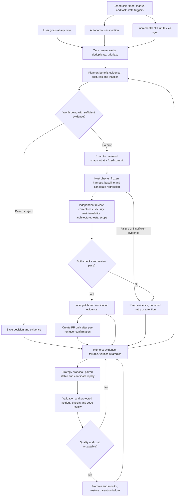

# Adaptive RSI

[简体中文](README.md) | **English**

A local autonomous improvement runtime for Codex: **code inspection, user goals, and GitHub Issues → task queue → value assessment → planning → isolated implementation → independent checks and review → local candidate → per-run PR confirmation → memory and the next round**.

Includes a plugin entry point, persistent scheduler, SQLite state and call budgets, protected evaluator, strategy candidate archive, and a Chinese/English dashboard. Requires Python 3.9+; the runtime has no third-party Python dependencies.

## Workflow



The scheduler waits between scans instead of continuously invoking models; queued tasks proceed when ready. **PRs are never created automatically; merging is manual.** Local verification does not establish that a change is merged or that deployment works. Strategy evolution runs through a separate protected experiment loop and cannot rewrite permissions or acceptance rules.

## Code quality gates

Implementation and review use separate sessions with different permissions. Review can use a different provider. All six review areas require reasoned assessments; actionable findings include severity, file, line, impact and a suggested change. Reports appear in task details.

The default threshold blocks **medium and above**, configurable to high or low. Critical and high findings always block. A failed area or insufficient evidence also blocks delivery. A reported pass cannot override a blocking finding: the host enforces the outcome. Failed reports enter subsequent retry context.

Maintainability review covers duplication, unnecessary abstraction, complex branches, coupling, naming and project conventions. It targets introduced issues without demanding unrelated refactoring. Add project lint, type, complexity or dependency checks to `checks` for deterministic gates alongside tests; the runtime does not automatically impose a static-analysis tool suite. Model review can miss problems and cannot guarantee code quality.

Both ordinary tasks and strategy replay use these gates. Paired experiments review both variants and count review costs symmetrically. The default experiment call cap is 40; the project daily cap remains 30. Check both before a formal experiment. Exhaustion stops work without silently increasing limits.

## Decide whether work is worthwhile

User goals, inspections and Issues share one value gate. Planning checks current behavior, duplicates and existing fixes, then records benefit, impact, cost, confidence, concrete evidence and the consequence of doing nothing:

- **Execute:** evidence and value justify the cost, with bounded scope and observable acceptance criteria.
- **Defer:** unclear requirements, weak evidence or low current priority. Reassess only after a baseline commit, evidence or value-policy change, avoiding repeated model spending.
- **Reject:** cosmetic churn, disproportionate cost or conflicting direction. Keep the reason; the user may explicitly reconsider it.

The host holds execution suggestions with low confidence, missing evidence or low impact combined with high effort. Edit the policy in Settings and inspect decisions in task details. Model judgment can still be wrong; this gate does not guarantee objective benefit.

## Official APIs, gateways and local models

Choose models per role using either Codex execution or host-controlled native API execution:

| Protocol / route | Services | Example base URL |
| --- | --- | --- |
| Codex CLI | Default OpenAI/Codex, Codex-compatible gateways, local OSS | Codex authentication or compatible Responses endpoint |
| Responses | OpenAI API, compatible gateways | `https://api.openai.com/v1` |
| Chat Completions | DeepSeek, compatible Qwen/other endpoints, gateways, LM Studio | `https://api.deepseek.com` |
| Anthropic Messages | Anthropic API, compatible gateways | `https://api.anthropic.com/v1` |
| Gemini GenerateContent | Google API, compatible gateways | `https://generativelanguage.googleapis.com/v1beta` |
| Native Ollama | Local tool-capable models | `http://127.0.0.1:11434` |

Native routes supply host-controlled read, search, edit and sandbox command tools without requiring Codex CLI. Planning and review are read-only; implementation can write and execute. Models must support tools and the required structured result. Text-only models cannot execute these roles. **Protocol support does not establish tested compatibility with every vendor, model version or gateway.** Non-standard APIs still need adapters.

**Model center** in the sidebar has **Providers & models** and **Role assignments** pages. Add multiple independent connections for official APIs, gateways or local services. Presets fill the endpoint and protocol; advanced settings support custom protocols.

1. Add a connection with a name, endpoint and API key, then **Save & fetch models**. macOS defaults to Keychain; other systems can use process memory or environment variables. Keys entered in the UI are available immediately without restart. The form clears after submission; keys are not placed in browser local storage or returned in API responses.
2. Fetch a shared directory per connection, search, enable models or add custom IDs. Directories, timestamps and preferences persist in local state across reloads and restarts. Failed refreshes keep the old directory. Missing models are marked without replacing existing assignments. Endpoint, protocol or credential-version changes invalidate old directories and test evidence.
3. In **Role assignments**, choose from searchable provider groups and save. Supported efforts from directory metadata are shown when available; unknown support defaults to provider settings. Responses / Chat Completions / Codex routes allow explicit effort overrides and fallback routes in advanced parameters. Native Anthropic, Gemini and Ollama retain `default`. Default planning/review remains `gpt-6.1-sol / high`, implementation `gpt-6-luna / max`.
4. Select global defaults or project overrides using **Scope**. Directory preferences and assignments are saved independently per project. Saving **Inherit global configuration** removes project role overrides so later global changes propagate. Connections referenced by a role or fallback cannot be removed.

The default Codex route reads [App Server `model/list`](https://developers.openai.com/codex/app-server#list-models-modellist). Responses, Chat Completions, Codex-compatible gateways and Anthropic use `/models`; Gemini uses `/models` and filters entries explicitly lacking `generateContent`; Ollama uses `/api/tags`; LM Studio uses `/v1/models`. Pagination fetches up to 1,000 entries per refresh while retaining prior and custom entries. Explicit image/embedding and other non-coding types cannot be enabled; unknown capabilities are not assumed to be supported.

Fetching a directory starts no inference task and consumes no model-call budget. **Test** explicitly runs a basic tool-call and structured-output check. Its dialog explains possible charges; calls count toward the current project or global test scope's daily limit and record actual tokens. No project code is sent; software updates wait for tests to finish. Credentials, directory and test states are distinct. **Passing this check does not establish real project capability or support for other effort settings.**

```json
{
  "providers": [{"id":"gateway","name":"My model gateway","protocol":"chat_completions","base_url":"https://models.example.com/v1","env_key":"RSI_MODEL_API_KEY"}],
  "models": {
    "implementation": {"provider":"gateway","model":"your-coder-model","effort":"default"},
    "review": {"provider":"openai","model":"gpt-6.1-sol","effort":"high"}
  }
}
```

The JSON example uses an environment variable: `env_key` is its **name**, never a key value. Changing the service environment still requires restart. Keychain/session modes store only `credential` and a random `secret_ref` in configuration. Session keys must be entered again after restart. Keychain storage is namespaced by local state directory; raw keys are not written to settings, database, events or command arguments. Native command tools/checks do not inherit keys. Codex-compatible routes receive them through a dedicated process environment variable. Remote endpoints require HTTPS; loopback allows HTTP. Select **No key required** for anonymous local services. Provider lists replace the entire list; IDs must be unique. Legacy providers without `protocol` retain Codex routing.

Explicit cross-provider fallback is available through advanced configuration:

```json
{"models":{"implementation":{"fallback":{"provider":"ollama","model":"your-local-coder","effort":"default"}}}}
```

Only availability/rate-limit errors trigger fallback. Native execution cannot fall back after mutating tools, avoiding mixed partial implementations. Check/review failures cannot be bypassed by switching models. Calls record actual provider, model, effort and usage. Model, endpoint or review changes invalidate previous strategy compatibility evidence.

**Budget units differ:** Codex counts CLI sessions; native routes count each HTTP request, including tool round trips. Native execution usually needs higher per-run/daily limits. The existing default of 5 per run may be insufficient; adjust it deliberately. Limits never expand automatically, and paid connection tests never start automatically.

Protocol references: [Responses tools](https://developers.openai.com/api/docs/guides/function-calling), [Anthropic tools](https://platform.claude.com/docs/en/agents-and-tools/tool-use/overview), [Gemini function calling](https://ai.google.dev/gemini-api/docs/function-calling). Local protocol fixtures pass; live vendor invocations remain unverified.

## Quick start

On macOS, double-click `启动 Adaptive RSI.command`, or run from this directory:

```sh
python3 scripts/start.py
```

The launcher reuses an existing service. Closing the browser does not stop scheduling. Work pauses during sleep; missed triggers are coalesced on resume. To stop the service, send SIGTERM to its PID in `server.json`, or run in the foreground and press Ctrl+C:

```sh
python3 -m adaptive_rsi serve --open
python3 scripts/rsi doctor
```

In **Add project**, choose a local Git repository or **GitHub URLs**, one repository per line. GitHub import uses your authenticated `gh`, clones separately and starts paused. Local repositories need an existing commit. Review settings, then enable each project. No initial goal is required.

The dashboard defaults to Chinese. Select **English** in the top bar; the browser remembers the choice. Task content, model output, raw logs, and evidence retain their original language. CLI commands and configuration keys remain English.

State defaults to `~/.local/share/adaptive-rsi`. Override it with `ADAPTIVE_RSI_HOME` or `--state-dir`. Keep state outside managed project trees. The dashboard listens only on `127.0.0.1`. Its login URL contains a local session token: do not share it. Reopen with `python3 scripts/rsi open`.

## The improvement loop

- **Scheduling:** light inspection every 120 minutes, incremental Issues sync every 60 minutes, and deep inspection every 4320 minutes. Configure time zone and working hours. Ready tasks continue without waiting for the next inspection. Light inspection skips model calls when the committed snapshot is unchanged; deep inspection rotates modules. Resume does not replay every missed trigger.
- **Models:** analysis, planning, review, and improvement proposals use `gpt-6.1-sol / high`; implementation uses `gpt-6-luna / max`. The selected protocol enforces these routes. Fallbacks must be explicitly configured; failures are recorded. Paid probes never start automatically. Explicit tests are available in Model center; project acceptance still establishes real task capability.
- **Task sources:** discovered tasks require verifiable references to existing code. User goals can enter at any time. Issues support label filters, update cursors, deduplication, closed-Issue checks, and existing PR context. Issue text does not grant permissions.
- **Isolation and verification:** each run uses clones of a fixed Git commit and leaves the user's worktree untouched. Implementation and review use separate sessions. The host freezes check commands and reruns baseline and candidate checks independently. Original tests and build entry points are restored from the baseline and protected against writes during checks. Model claims do not establish success. Missing checks, zero tests, or insufficient evidence block delivery.
- **State and budgets:** service/project locks, atomic task claims, frozen configuration, reserved model calls, daily/per-run limits, run and command timeouts, output limits, bounded backoff retries, pause/cancel, and fresh-snapshot recovery after crashes. Actual tokens and elapsed time are recorded; dollar costs are not invented. Codex counts CLI sessions, while native routes count HTTP requests; neither is a strict monetary budget.
- **Delivery:** keep patches and evidence locally after verification. Confirm each run in task details or use `deliver RUN_ID` before a branch is pushed and a PR created. No automatic merging. Legacy automatic PR/merge settings migrate to local-only delivery. The runtime does not rewrite the user repository or discard uncommitted work.
- **Strategy evolution:** execution strategies, meta-strategies, and adapter guidance evolve as retrieved instructions. Candidates cannot change the controller, permissions, budgets, or evaluator. Validation and holdout tasks compare stable and candidate strategies in paired runs. Promotion requires improved quality, no observed regression, and acceptable time/token costs. Early monitored failures restore the previous stable strategy and invalidate its learned skills. Observations, verified skills, and failed candidates are stored separately.

## Environment and boundaries

The fully supported execution environment is currently **macOS Seatbelt**. Codex workers require Seatbelt; native command tools and deterministic checks use Seatbelt or Docker. Linux can serve the dashboard, but native Docker execution has not been validated on a real Linux host and Codex workers are blocked. Windows hosting is unsupported. Docker requires a running daemon and pre-pulled trusted image, disables network/host credentials and limits resources. Images and dependencies are never fetched automatically.

Adapters recognize Java/Kotlin (Maven, Gradle), JavaScript/TypeScript (npm, pnpm, Yarn), Python, Go, Rust, C/C++, .NET, PHP, Ruby, Swift/Objective-C, and Dart/Flutter, and analyze SQL, Shell, PowerShell, HTML/CSS, Docker, and CI configuration. Capability states distinguish unverified, analysis-only, and environment-blocked projects. Xcode, Make, and other project-specific builds need explicit commands. Uncached dependencies require environment preparation. Detection does not certify all builds for a language.

Acceptance relies on fixed project checks. Configure appropriate checks where missing; model review cannot replace tests. Frozen tests, separate sessions, and OS sandboxes reduce tampering risk but are not a formal security proof against arbitrary malicious code. The selected execution route handles model authentication and networking. Code context goes to the selected provider under that provider's data policy. The runtime does not independently publish local dashboard data, logs, or memory.

Long-term recursive improvement requires real tasks and sustained experiments; this release does not claim to have demonstrated it. Without protected evaluation cases, candidates can be proposed and archived but **cannot be automatically promoted**. Scheduling is periodic or manual. There is no OS startup service or native Codex settings page.

## Configuration and CLI

Precedence: **task overrides > project overrides > global defaults**. Active runs retain their initial configuration. The dashboard exposes common settings; advanced JSON and the CLI cover the full configuration.

```sh
python3 scripts/rsi add /path/to/repository
python3 scripts/rsi import https://github.com/owner/project-a https://github.com/owner/project-b
python3 scripts/rsi status
python3 scripts/rsi resume PROJECT_ID
python3 scripts/rsi goal PROJECT_ID 'Fix pagination boundaries and add regression checks'
python3 scripts/rsi inspect PROJECT_ID --deep
python3 scripts/rsi issues PROJECT_ID
python3 scripts/rsi pause PROJECT_ID
python3 scripts/rsi config --project PROJECT_ID --json '{"schedule":{"light_minutes":240},"limits":{"daily_calls":20}}'
python3 scripts/rsi goal PROJECT_ID 'Improve error handling' --overrides '{"limits":{"run_seconds":1200}}'
python3 scripts/rsi deliver RUN_ID
python3 scripts/rsi retry TASK_ID
python3 scripts/rsi rollback CANDIDATE_ID
python3 scripts/rsi update check
python3 scripts/rsi update apply --confirm
```

Fixed checks use argument arrays, not shell concatenation:

```json
{"checks":[{"name":"unit regression","cwd":".","argv":["python3","-m","unittest","discover","-s","tests","-v"]}]}
```

Prepare dependencies in a trusted container image or explicitly select untracked in-project dependency directories as snapshot sources. Implementation and verification get separate copies; verification restores the same frozen dependencies without changing the original directory:

```json
{"environment":{"seed_paths":["node_modules"],"max_seed_mb":1024,"setup":[]}}
```

`setup` accepts offline preparation commands in the same format as `checks`. External symlinks, missing dependencies, or failed preparation block execution. A pnpm directory linked to a global store or a virtual environment pointing outside the project may require a self-contained image. The runtime does not expose the entire home directory for compatibility.

## Multiple isolated projects

Each GitHub URL gets a project ID, separate clone, task queue, Issue cursor, configuration, daily budget, run evidence, memory and strategies. The default import location is `adaptive-rsi-projects/owner--repo` beside the state directory. Reimporting the same repository returns its existing project.

Switch projects in the top bar. Global defaults and concurrency are shared; project overrides are separate. Nested directories are rejected. Model/check processes cannot read other registered repositories; command tools do not inherit provider secrets. Wait for active runs to finish before registering another project so every running worker has consistent isolation boundaries. This remains one local user/service, rather than a multi-tenant system.

## User software updates

Global update settings offer manual checks, notifications (default: every 1440 minutes), or automatic stable patch updates while idle. Automatic installation stays within one major/minor series, such as `0.2.0 → 0.2.1`; other versions require confirmation. Active work waits until idle.

The updater downloads official ZIP/SHA-256 assets from this repository's GitHub Releases, validates paths/version/state compatibility, installs versioned directories, backs up SQLite, restarts and checks health. Failed startup restores previous code and database. Configuration, projects and history are preserved. Source checkouts are never updated with `git pull`. Checksums verify integrity; independent release signing is not implemented.

This updates the runtime. Already loaded Codex skills/metadata still require marketplace refresh and a Codex restart. A lasting local marketplace installation may point at `~/.local/share/adaptive-rsi/installations/current`, available after the first successful managed update. Existing wheel entry points are not replaced: use plugin `scripts/rsi` / `scripts/start.py` or update the pip package. Local updater tests pass; **users receive an update only after a maintainer publishes the required release assets**. Power loss and supervisor crashes are outside the verified recovery scope.

Maintainer instructions: [RELEASING.en.md](RELEASING.en.md).

## Independent evaluation cases

Import real historical fixes or synthetic defects confined to evaluation snapshots. Example manifest:

```json
{
  "family": "pagination-empty-last-page",
  "split": "holdout",
  "source": "real",
  "repository": "/path/to/evaluation-fixture",
  "base": "COMMIT_SHA",
  "task": "Fix total counts and page calculations for an empty last page.",
  "checks": [{"name":"acceptance","cwd":".","argv":["python3","-m","unittest","discover","-s","tests","-v"]}],
  "overlay": "/path/to/protected-tests"
}
```

```sh
python3 scripts/rsi import-case PROJECT_ID case.json
python3 scripts/rsi evolve PROJECT_ID
```

Splits are `development`, `validation`, and `holdout`. A family or identical task snapshot cannot span splits; curators must label near-duplicate defect families correctly. Defaults require at least three families in both validation and holdout, with at most three exposures per case. The controller stores overlays and injects them into test directories only during independent evaluation, without giving them to candidates. Synthetic defects stay out of the real project queue and are not presented as business evidence.

## Codex plugin

`plugin.json` is an Agent Plugins 1.0 manifest. `.agents/plugins/marketplace.json` provides a local catalog entry, and `skills/` contains the skills. Add this project through a Codex plugin catalog supporting local marketplaces, then run setup. Installation and reload interfaces vary by client; the runtime does not alter your personal plugin catalog. The launcher also works without plugin installation.

## Development and validation

```sh
python3 -m unittest discover -v
node --check adaptive_rsi/web/app.js
node --check adaptive_rsi/web/i18n.js
```

Tests substitute the model interface while running real Git snapshots, SQLite concurrency, macOS sandbox checks, and regression checks. They do not consume model sessions or write to GitHub. Browser checks cover desktop/mobile layout and settings persistence. Live model authorization, long-running operation, and remote PR integration require a real project.

See [the validation report](VALIDATION.en.md) and [contribution guide](CONTRIBUTING.en.md).
