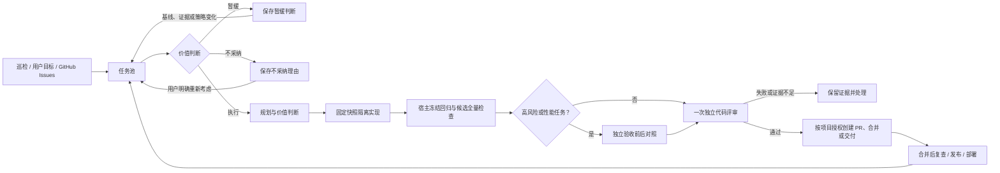

# Adaptive RSI

**简体中文** | [English](README.en.md)

让 AI 在隔离环境中持续检查、修复和改进你的软件项目。

Adaptive RSI 会把项目巡检、用户目标和 GitHub Issues 转成经过价值判断的维护任务。修改经过规划、隔离实现、宿主检查和代码评审；高风险与性能任务另做独立验收。只有项目明确授权后，才创建 PR、合并或交付。

[](https://github.com/Haoog/Adaptive-RSI/releases/latest)
[](pyproject.toml)
[](LICENSE)

[下载桌面版](https://github.com/Haoog/Adaptive-RSI/releases/latest) · [快速开始](#快速开始) · [详细文档](#文档) · [运行边界](#安全与边界)

[手机安装与流程指南](EXPERIENCE.md) · [本批加固与配置说明](docs/audit-hardening.md)

## 它解决什么

普通的自动编程工具容易把每个建议都当成任务，甚至在没有充分验证时交付改动。Adaptive RSI 在实现前后加入四道约束：

- 先判断问题是否真实、重复和值得做。
- 在固定 Git 快照中修改，不碰用户工作目录。
- 行为、配置和界面修改用隔离运行的新增回归测试验证基线失败、候选通过，并结合冻结回归和代码评审；不支持隔离调用的运行器、高风险及性能任务使用独立验收。
- 只有项目明确授权后，才创建 PR、合并、发布或部署。

项目检查与 Issues 同步默认每小时运行，可以自定义、暂停或跟随通用设置。不设调用次数、任务时长或发现数量额度；tokens 和可用费用估算只做记录。

## 工作流程



每个项目的模型、任务、记忆、用量和交付授权相互独立。暂停或撤销授权会阻止尚未发出的后续操作。

任务列表支持预览后批量重试、取消或批准交付，也可将同一项目中兼容的排队目标合并验证；合并前会提示已知文件重叠和未知范围。合并任务尚未开始时，可以拆分并恢复原任务。

取消任务时先预览受影响的后继，默认只取消当前任务；连带取消需要明确选择。需求修订可查看准确的前后快照与差异，并逐页追溯历史。任务详情中的人工干预记录保留可选原因、具体候选和操作效果，支持导出已加载记录。使用范围与历史证据限制见[流程与手机使用](EXPERIENCE.md)。

## 快速开始

### 桌面版（推荐）

1. 从 [最新正式版](https://github.com/Haoog/Adaptive-RSI/releases/latest) 下载 macOS ARM64 DMG。
2. 打开应用，添加 GitHub 仓库或本地 Git 项目。
3. 连接模型，选择规划、实现和评审使用的模型。
4. 点击项目的「开始运行」。

自定义模型 ID 最多 256 个字符；显示名称可选，留空使用完整 ID。填写的自定义显示名称最多 160 个字符，获取模型目录时会保留；服务提供的名称仍随目录更新。

关闭窗口会隐藏到菜单栏，正在运行的任务继续执行；从菜单栏选择「退出」会停止应用自己启动的服务。当前 DMG 使用临时签名，尚未 Apple 公证。

配置更新签名的桌面版本可在后台检查并下载更新，选择手动安装或等待任务空闲后安装；更新会先验证签名，并等待本地工作结束。未配置签名时可从正式发布页面手动下载。详见[桌面版说明](DESKTOP.md)。

### 从源码启动

需要 Python 3.9+ 和 Git；GitHub 导入与交付还需要已登录的 `gh`：

```sh
python3 scripts/start.py
python3 scripts/rsi doctor
```

启动器会复用已有服务。任务详情中的前置任务可逐页选择；未保存的排队设置在切换语言和保存补充需求后保留。设置保存期间的后续草稿在切换项目后仍保留；用量搜索会使旧请求失效，避免迟到响应覆盖新查询。控制台持续显示设置是否保存：扫描时间保存后重排，模型分工单独保存并用于新任务，运行中任务保留原配置，交付授权在执行前复核，无需重启。固定检查可逐项编辑，检查结果与手机审批摘要可直接阅读并展开原始证据。未确认目标可从表单恢复原文并复用请求标识；数据与诊断中的待批准数量会排除已批准、交付中和已取消的候选，恢复失败不会留下不可重试的半成品目录；Issue 同步只统计实际新增任务或正文、证据变化，扫描未完成时会明确提示并在下一轮继续，已打开的任务详情也会随同步更新且保留未保存草稿。数据库恢复后的证据边界和操作说明见[流程与手机使用](EXPERIENCE.md)。服务器安装和开机常驻见[服务器部署](SERVER.md)。

## 核心能力

- **持续发现**：每小时检查 bug、功能缺口、性能、体验和维护问题，轮换代码模块；也可增量同步 GitHub Issues 或随时输入目标。
- **价值门禁**：先核对现状、证据、重复任务、预期收益、成本和不做的影响，避免为了改而改。
- **隔离与验证**：实现与评审使用独立上下文；宿主隔离运行新增测试验证基线失败、候选通过，并执行冻结回归和候选完整检查。不支持隔离调用的运行器、高风险及性能任务使用独立验收。
- **代码评审**：检查正确性、安全、可维护性、架构、测试和改动范围；阻断问题及证据不足会阻止交付。
- **可控交付**：默认保留本地候选；可按项目开启自动 PR、检查通过后自动合并，以及固定工作流发布或部署。
- **多项目与多模型**：多个 GitHub 仓库分别克隆和管理；项目选择器显示名称与路径，同名仓库可区分。支持官方服务、中转站、本地模型、Codex 和 OpenCode。

## 模型支持

| 使用方式 | 适用场景 |
| --- | --- |
| Codex CLI | OpenAI/Codex 账号及兼容 Responses 的网关 |
| OpenCode CLI | OpenCode 1.19.3 / 2.1.3 已配置的供应商及 API/OAuth 登录 |
| Responses / Chat Completions | OpenAI 官方 API、DeepSeek、兼容 Qwen、中转站和 LM Studio |
| Anthropic / Gemini | 官方 API 及兼容网关 |
| Ollama | 本机支持工具调用的模型 |

模型必须支持工具调用和结构化结果。支持某种协议不等于所有厂商、模型版本或中转站都已实测兼容。基础连接操作见[账号与模型说明](docs/accounts.md)，思考深度、价格估算和故障恢复等完整配置见[高级使用与配置](docs/advanced.md)。

## 安全与边界

- 面板只监听 `127.0.0.1`，登录链接含有本地会话令牌，不要分享。
- 新项目默认暂停，交付默认保留在本地；PR、合并、发布和部署分别授权。
- 目录查询和普通配置保存不会自动调用付费模型；主动测试模型可能产生费用。
- 代码上下文会发送到所选模型服务，实际数据政策由对应供应商决定。
- 固定检查、独立会话和操作系统沙箱能降低风险，但不构成对任意恶意代码的形式化安全证明。

长期能力提升仍需真实任务和持续实验。没有受保护评估样本时，只能提出并保存策略候选，不能自动晋升。

## 文档

| 内容 | 文档 |
| --- | --- |
| 桌面安装、生命周期和平台限制 | [桌面版](DESKTOP.md) |
| Codex、OpenCode、API 与本地模型 | [账号与模型](docs/accounts.md) |
| 详细设置、CLI、隔离和高级配置 | [高级使用与配置](docs/advanced.md) |
| 可靠性门禁、策略实验和恢复 | [可靠改进闭环](RELIABILITY.md) |
| 发布、部署、健康检查和用户更新 | [发布与更新](RELEASING.md) |
| Linux/systemd 与 HTTPS 部署 | [服务器部署](SERVER.md) |
| 自动化测试与真实联调证据 | [验证记录](VALIDATION.md) · [真实联调](LIVE_VALIDATION.md) |
| 开发、测试和提交约定 | [贡献指南](CONTRIBUTING.md) |

## 开发与验证

```sh
python3 -m unittest discover -v
node --check adaptive_rsi/web/app.js
node --check adaptive_rsi/web/i18n.js
npm run test:browser
```

日常测试通过替代模型接口执行，不消耗模型调用。完整环境和浏览器测试要求见[贡献指南](CONTRIBUTING.md)。

## 许可证

本项目使用 [MIT License](LICENSE)。

失败或取消的任务组可预览后拆分重做，原任务恢复排队并各自重新验证，旧分组证据保留。分组后修订的完整要求会另建任务重新验证，避免猜测归属或丢失补充要求。任务详情可分页查看分组关联和整组成果；整组通过不代表每条要求有独立证据。

桌面替换期间，安装进程仍存活时不会因超时放开任务准入。若所属安装进程在停止服务前退出，服务会记录恢复事件并解除屏障，任务保持不变。进程状态未知时继续阻止新任务；旧版无进程标记的屏障通过桌面所属重启或显式租约取消恢复。

排队设置支持选择最多 100 个前置任务，整条前置图最多 1000 个祖先节点；全部合并后才会开始。循环、缺失节点和跨项目依赖会被拒绝。某个前置任务失败或取消后，待办转为需人工处理的阻塞状态，其他前置关系继续保留。多选草稿会跨候选分页、语言切换和详情刷新保留。

实验卡同时展示配对质量、Token 用量（不是金额）和延迟，按真实/合成任务与任务长度分组；未知用量或零基线保持不可比较，已观察到的分组退化不会被隐藏。展开卡片可查看并导出记录的计划、输入清单及依据。原生工具活动记录调用哈希、状态和耗时，不保存参数正文、源文件正文或命令输出；取消搜索会保留有界文件/行号位置。只有开始回执而无结束回执的步骤需核对，不会自动重放。读取每 64 KiB、搜索每 256 行检查取消；单个被操作系统阻塞的文件系统调用不能由这些协作检查强制中断。

数据库诊断将慢查询指纹与不含正文的请求/任务/运行 ID 关联，区分 SQL 执行和连接等待，不记录 SQL 正文及绑定参数。连接等待分位数包含容量超时，并声明进程和样本窗口口径。普通指标不做完整关系扫描；显式诊断检查项目归属及证据关联，逐项说明是否截断。显式孤儿 stage 隔离按有界事务处理，保留所有原始列，不自动清理其他类型证据。

设置页提供脱敏变更记录和安全撤销；只有版本与内容仍匹配的最新修改可以撤销。并发或全局更新会阻止过期撤销。

部署可配置连续成功门禁和多个健康检查地址；每轮全部端点确认相同提交后才累计成功，正向上线和回滚采用相同规则。

自动部署回滚还要求显式确认数据向后兼容；未确认时会阻止回滚并显示维护者记录的人工恢复步骤。

执行资源按模型、命令和独占性能评估排队；等待达到 30 秒的请求优先按先后顺序处理，诊断中提供有界等待样本和取消回执。

可选磁盘和内存低水位准入会保留新任务排队，并在资源恢复后继续领取；两项默认关闭，配置后读数不可用时也会等待并说明原因。

差异阅读按文件折叠并在展开时加载正文；手机默认换行，搜索自动展开匹配文件，长差异也按实际换行位置定位。

任务详情可展开“为什么还没开始”，同时查看依赖链、暂停、退避、工作时段、全局容量及资源压力等原因；解除一个条件后其他条件仍保留。

配置校验会显示对应语言的稳定原因和安全字段路径；未知请求错误保留可复制诊断标识，方便在日志中核对。

项目和页面导航进入浏览器历史，前进后退及刷新保留对应项目；通知打开的任务详情可随历史恢复，关闭详情保留项目和页面位置。
