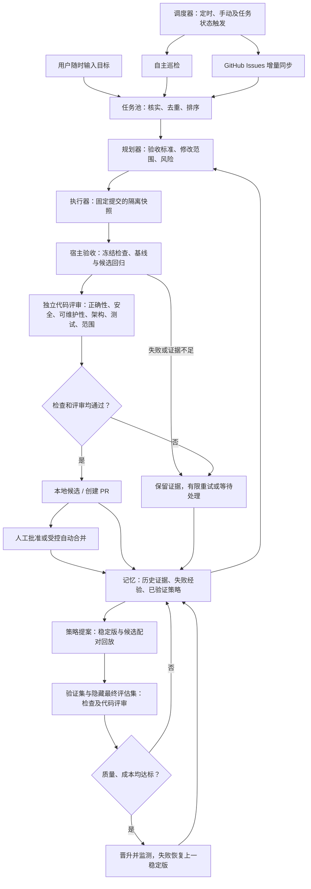

# Adaptive RSI

**简体中文** | [English](README.en.md)

面向 Codex 的本地自主改进运行器：**自主巡检、用户目标、GitHub Issues → 任务池 → 规划 → 隔离实现 → 独立验收 → 本地候选 / PR → 记忆与下一轮**。

包含插件入口、持久化调度器、SQLite 状态与预算、受保护评估器、策略候选档案和中英双语可视化控制台。Python 3.9+，运行器没有第三方 Python 依赖。

## 工作流程



调度器不持续空转调用模型：到期才扫描，已有任务按队列处理。自动 PR、自动合并分别配置；本地验收成功不等于已合并，也不代表合并后部署已验证。策略演化是另一条受保护的实验闭环，不直接改写自身权限或验收标准。

## 代码质量门禁

实现者和评审者使用独立、权限不同的会话，可为评审者选择不同模型服务。评审必须逐项说明六个维度的判断，问题包含严重级别、文件、行号、影响及修改建议，结果可在任务详情查看。

默认阻断**中及以上**问题，可在设置中调整为高或低；致命和高等级始终阻断。任一维度不通过或证据不足，同样不能交付。即使模型一边说“通过”、一边列出阻断问题，宿主也会判定失败。失败记录进入后续重试上下文。

可维护性重点包括重复逻辑、无必要的抽象、复杂分支、模块耦合、命名与项目约定；评审应针对本次引入的问题，不强迫无关重构。将项目的 lint、类型检查、复杂度或依赖规则命令加入 `checks`，可与测试一起作为硬门禁；运行器不会擅自替项目选择全套静态分析工具。模型评审仍可能漏判，不能保证消除所有质量问题。

普通任务和策略回放都适用门禁。配对实验两边均执行评审，成本记录包含评审，避免只给成功一边增加评审费用而扭曲比较。默认单次实验会话上限调整为 40；项目每日会话上限仍为 30，准备正式实验时需同时检查两者，预算不足会停止，不会自动扩额。

## 非 GPT 模型与服务配置

执行工具仍由 Codex CLI 提供，模型名称和服务可以分角色配置，并不限于 GPT：

| 接入方式 | 配置 | 兼容要求 |
| --- | --- | --- |
| OpenAI / Codex | `provider: "openai"`，默认 | 使用现有 Codex 认证 |
| 本地 Ollama | `provider: "ollama"` | Codex OSS 模式、可用的本地模型及工具调用能力 |
| 本地 LM Studio | `provider: "lmstudio"` | 同上，服务需先启动 |
| 第三方网关 / 自建服务 | 在服务列表添加，再按 ID 选择 | 兼容 Responses 流式协议、工具调用及结构化输出 |

原生 Anthropic Messages、Gemini GenerateContent 和仅 Chat Completions 的服务**尚未直连**，须先通过兼容网关。不能仅凭模型名称声称 Claude、Gemini、DeepSeek、Qwen 等具体版本已经可用。模型/服务兼容性由首次实际调用确认，不会静默替换。

控制台「运行设置 → 模型与推理强度」可添加服务、编辑地址、选择各角色服务/模型及评审门槛。第三方或本地模型建议先选 `default`（服务默认），运行器不再强行附加 GPT 推理参数；显式选择强度时须由该服务支持。

示例配置（模型 ID 按实际服务填写）：

```json
{
  "providers": [{"id":"gateway","name":"我的模型网关","base_url":"https://models.example.com/v1","env_key":"RSI_MODEL_API_KEY"}],
  "models": {
    "implementation": {"provider":"gateway","model":"your-coder-model","effort":"default"},
    "review": {"provider":"openai","model":"gpt-6.1-sol","effort":"high"}
  }
}
```

`env_key` 填写**环境变量名**，不填密钥。密钥通过启动服务进程的环境提供；已有服务需要重启才能继承新的环境变量。服务配置、数据库和命令参数不保存密钥值；模型子进程会继承启动环境，项目检查进程使用隔离环境。不要在项目文件或控制台中粘贴密钥。远端地址要求 HTTPS，本机回环允许 HTTP；无认证的本地服务可将 `env_key` 留空。自定义服务列表为整体替换，ID 不可重复。

备用路由通过高级配置显式指定，可跨服务，例如：

```json
{"models":{"implementation":{"fallback":{"provider":"ollama","model":"your-local-coder","effort":"default"}}}}
```

仅服务/模型不可用或限流等错误会触发备用路由；检查或代码评审失败不会靠换模型绕过。每次会话记录实际服务、模型、强度与用量。更换模型、服务地址或评审规则会使旧策略验证证据失配，需要重新验证后才能沿用。

接入依据：[Codex 官方高级配置文档](https://developers.openai.com/codex/config-advanced/)。当前已验证参数路由和本地替代流程，尚未验证真实第三方或本地模型端到端执行。

## 启动

macOS 双击 `启动 Adaptive RSI.command`，或在本目录执行：

```sh
python3 scripts/start.py
```

启动器会复用现有服务；关闭浏览器不停止调度。电脑休眠时工作暂停，恢复后合并遗漏触发。关闭服务可对 `server.json` 中的本服务 PID 发送 SIGTERM，或使用前台模式按 Ctrl+C：

```sh
python3 -m adaptive_rsi serve --open
python3 scripts/rsi doctor
```

在控制台「接入项目」填写**已有提交的 Git 仓库根目录**，确认设置，然后启用。注册默认暂停，启用后才会调用模型。无需先输入目标。

界面默认中文，可在顶部切换 English，并在当前浏览器中记住选择。用户目标、模型输出、原始日志和证据保留原文；CLI 命令与配置字段保持英文。

状态默认存放于 `~/.local/share/adaptive-rsi`，可通过 `ADAPTIVE_RSI_HOME` 或 CLI 的 `--state-dir` 指定独立目录。状态应位于受管项目目录树之外。控制台只监听 `127.0.0.1`，登录链接含本地会话令牌，不要分享；服务启动后可用 `python3 scripts/rsi open` 再次打开。

## 已实现的闭环

- **调度**：轻巡检 120 分钟、Issues 增量同步 60 分钟、深巡检 4320 分钟；可配置工作时段和时区。任务就绪即继续处理，不等待下次巡检。轻巡检发现已提交快照未变时不调用模型。深巡检轮换模块；开机/恢复不回放所有错过的定时任务。
- **模型**：理解、规划、审查和改进提案使用 `gpt-6.1-sol / high`；实现使用 `gpt-6-luna / max`。每轮通过 CLI 参数实际路由。备用模型必须显式配置，调用失败会记录。无付费模型探测；真实可用性由首次调用确定。
- **三种任务来源**：自主发现需要现有源码的可核实引用；用户目标可以随时入队；Issues 支持标签过滤、更新时间游标、重复去除、关闭检查及已有 PR 上下文。Issue 内容不授予权限。
- **隔离与验证**：每轮从固定 Git 提交生成独立克隆，不写入用户工作目录。实现与审查分开会话；宿主固定验收命令，在独立目录重跑基线与候选。原有测试与构建入口由基线覆盖，并在检查进程中禁止写入。模型的成功文本不是验收结果。缺少检查、零测试或证据不足不会放行。
- **状态与预算**：单服务锁、项目锁、原子任务领取、配置快照、Codex 会话预留、每日/每轮会话上限、总时限、命令时限、输出上限、有限退避重试、暂停/取消、崩溃后的新快照重试。实际 token 与时长单独记录，不虚构美元成本。这里的调用上限计数 CLI 会话；一个会话可能包含多轮模型推理，不能把它当作 API 请求数或严格货币预算。
- **交付**：默认保留补丁和验收证据；可在任务详情批准创建 PR，或明确启用自动 PR。高风险计划保留本地等待交付。自动合并需另行开启，使用 GitHub 的自动合并和提交匹配约束。不会替你改写原仓库或清理未提交工作。
- **策略演化**：执行策略、元策略和适配指导是可演化的检索指令。候选不会修改控制器、权限、预算或评估器。候选在验证集和隐藏最终评估集上分别与稳定版配对运行；质量改善、无已观察退步、时间/token 成本达标才能晋升。初期任务失败会恢复上一稳定版并使对应技能失效。观察、验证后的技能、失败候选分开保存。

## 环境与实际边界

当前**模型工作进程完整执行支持 macOS Seatbelt**，与 Codex 自带的 workspace sandbox 叠加；检查支持 Seatbelt 或 Docker。Linux 等 POSIX 系统可运行控制台和识别代码，但模型工作进程目前明确阻塞；Windows 宿主暂不支持。Docker 检查要求服务已启动、可信镜像已提前下载，容器无网络、无宿主凭据，并限制 CPU、内存、进程数；不会自动拉取镜像或安装依赖。

适配器覆盖 Java/Kotlin（Maven、Gradle）、JS/TS（npm、pnpm、Yarn）、Python、Go、Rust、C/C++、.NET、PHP、Ruby、Swift/Objective-C、Dart/Flutter，并扫描 SQL、Shell、PowerShell、HTML/CSS、Docker 和 CI。状态分为**待验证、可分析、环境阻塞**。Xcode、Make 等需要项目特定命令；依赖未缓存的项目需要先准备环境。识别到语言不代表该语言的全部项目都已验证可执行。

当前验收以项目的固定检查为依据。项目没有合适测试时，应在设置中明确配置；不能把模型审查当作测试。固定测试、不同会话和操作系统沙箱降低篡改风险，但不构成抵御任意恶意代码的正式安全证明。模型认证和网络连接由 Codex CLI 处理；代码上下文会发往你选择的模型服务，其数据政策由对应服务决定。本地控制台、日志和经验不会被运行器自行公开上传。

长期递归提升需要真实任务和持续实验，当前产品不声称已经证明这种提升。没有受保护评估集时，可以提出和存档候选，**不能自动晋升**。当前采用周期调度与手动触发，不安装系统开机服务，不创建 Codex 原生设置页。

## 配置与 CLI

配置优先级：**单任务覆盖 > 项目覆盖 > 全局默认**。活动任务保留开始时的配置。可视化页面覆盖常用参数，高级 JSON 和 CLI 支持完整配置。

```sh
python3 scripts/rsi add /path/to/repository
python3 scripts/rsi status
python3 scripts/rsi resume PROJECT_ID
python3 scripts/rsi goal PROJECT_ID '修复分页边界并补回归测试'
python3 scripts/rsi inspect PROJECT_ID --deep
python3 scripts/rsi issues PROJECT_ID
python3 scripts/rsi pause PROJECT_ID
python3 scripts/rsi config --project PROJECT_ID --json '{"schedule":{"light_minutes":240},"limits":{"daily_calls":20}}'
python3 scripts/rsi goal PROJECT_ID '改进错误处理' --overrides '{"limits":{"run_seconds":1200}}'
python3 scripts/rsi deliver RUN_ID
python3 scripts/rsi retry TASK_ID
python3 scripts/rsi rollback CANDIDATE_ID
```

固定验收命令使用 argv 数组，不使用 shell 拼接：

```json
{"checks":[{"name":"unit regression","cwd":".","argv":["python3","-m","unittest","discover","-s","tests","-v"]}]}
```

依赖可通过可信的预制容器镜像准备，也可显式选择项目内未跟踪的依赖目录做只读来源快照。实现副本和验收副本分别复制，验收会恢复同一份冻结依赖；不会改变原目录。示例：

```json
{"environment":{"seed_paths":["node_modules"],"max_seed_mb":1024,"setup":[]}}
```

`setup` 可放置需要在隔离环境中执行的离线依赖准备命令，格式与 `checks` 相同。外部符号链接、缺失依赖或准备失败会明确阻塞。连接全局 store 的 pnpm 目录、指向宿主的虚拟环境可能需要改用独立镜像；运行器不会为了兼容而开放整个用户目录。

## 独立评估任务

真实历史修复或隔离环境中的合成缺陷均可导入。清单示例：

```json
{
  "family": "pagination-empty-last-page",
  "split": "holdout",
  "source": "real",
  "repository": "/path/to/evaluation-fixture",
  "base": "COMMIT_SHA",
  "task": "修复空末页时的总数与页码计算。",
  "checks": [{"name":"acceptance","cwd":".","argv":["python3","-m","unittest","discover","-s","tests","-v"]}],
  "overlay": "/path/to/protected-tests"
}
```

```sh
python3 scripts/rsi import-case PROJECT_ID case.json
python3 scripts/rsi evolve PROJECT_ID
```

`split` 为 `development`、`validation`、`holdout`。同一家族或同一任务快照不能跨集合；近重复缺陷仍需整理者正确标注家族。默认验证集和最终评估集各至少 3 个家族，最多曝光 3 次。overlay 由控制器保存，仅在独立评估时写入测试目录，不交给候选。合成缺陷只存在于评估副本，不会进入真实项目任务池。这里没有把自动生成的合成任务冒充真实业务证据。

## Codex 插件

根目录 `plugin.json` 使用 Agent Plugins 1.0 manifest；`.agents/plugins/marketplace.json` 提供本地目录条目，技能位于 `skills/`。可通过支持本地 marketplace 的 Codex 插件目录添加此项目；安装后运行 setup。不同客户端的目录重载/安装界面可能不同，未自动修改你的个人插件目录。也可直接使用上述启动器，无需先安装插件。

## 验证开发版本

```sh
python3 -m unittest discover -v
node --check adaptive_rsi/web/app.js
node --check adaptive_rsi/web/i18n.js
```

测试替代模型接口，真实执行 Git 快照、SQLite 竞争控制、macOS 沙箱和回归测试；不消耗模型调用或写入 GitHub。浏览器验收检查桌面/移动布局与设置保存。实际模型授权、长时间运行和远端 PR 合并需要在接入真实项目后再验证。

本次验证范围与未验证事项见 [VALIDATION.md](VALIDATION.md)。

欢迎提交 Issue 或 PR，详见[贡献指南](CONTRIBUTING.md)。本仓库提交说明使用中文。
