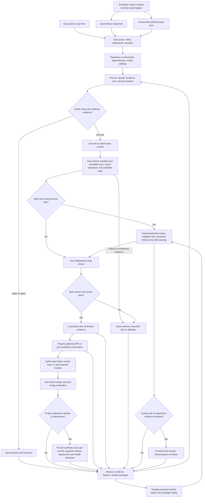

# Advanced usage and configuration

[Back to project home](../README.en.md) | [简体中文](advanced.md)

## Workflow



The scheduler waits between scans; queued tasks proceed when ready. Delivery defaults to local candidates. Projects explicitly authorize automatic PRs and merging. Missing or failed CI, required reviews, changed commits and conflicts block merging; admin bypass is never used. Release and deployment require separately authorized pinned workflows; selecting them does not change existing PR or merge settings. Merge checks, release, deployment and health checks have distinct outcomes: a successful workflow does not establish verified deployment health. Strategy evolution uses a separate protected experiment loop and cannot rewrite permissions or acceptance rules.

## Code quality gates

Implementation and review use separate sessions with different permissions. Review can use a different provider. All six review areas require reasoned assessments; actionable findings include severity, file, line, impact and a suggested change. Reports appear in task details.

The default threshold blocks **medium and above**, configurable to high or low. Critical and high findings always block. A failed area or insufficient evidence also blocks delivery. A reported pass cannot override a blocking finding: the host enforces the outcome. Failed reports enter subsequent retry context.

Maintainability review covers duplication, unnecessary abstraction, complex branches, coupling, naming and project conventions. It targets introduced issues without demanding unrelated refactoring. Add project lint, type, complexity or dependency checks to `checks` for deterministic gates alongside tests; the runtime does not automatically impose a static-analysis tool suite. Model review can miss problems and cannot guarantee code quality.

Ordinary tasks and paired strategy replays retain their independent gates. Experiments default to three cases per split and two repetitions. Promotion requires sufficient independent cases and quality evidence; repetitions are not independent samples. Calls, time and tokens are recorded without experiment quotas or cost-ratio gates.

## Decide whether work is worthwhile

User goals, inspections and Issues share one value gate. Planning checks current behavior, duplicates and existing fixes, then records benefit, impact, cost, confidence, concrete evidence and the consequence of doing nothing:

- **Execute:** evidence and value justify the cost, with bounded scope and observable acceptance criteria.
- **Defer:** unclear requirements, weak evidence or low current priority. Reassess only after a baseline commit, evidence or value-policy change, avoiding repeated model spending.
- **Reject:** cosmetic churn, disproportionate cost or conflicting direction. Keep the reason; the user may explicitly reconsider it.

The host holds execution suggestions with low confidence, missing evidence or low impact combined with high effort. Edit the policy in Settings and inspect decisions in task details. Model judgment can still be wrong; this gate does not guarantee objective benefit.

## Official APIs, gateways and local models

Choose models per role using either Codex execution or host-controlled native API execution:

| Protocol / route | Services | Example base URL |
| --- | --- | --- |
| OpenCode CLI | OpenCode provider connections and API/OAuth login | Fetch and select `provider/model` |
| Codex CLI | Default OpenAI/Codex and Codex-compatible gateways | Codex authentication or compatible Responses endpoint |
| Responses | OpenAI API, compatible gateways | `https://api.openai.com/v1` |
| Chat Completions | DeepSeek, compatible Qwen/other endpoints, gateways, LM Studio | `https://api.deepseek.com` |
| Anthropic Messages | Anthropic API, compatible gateways | `https://api.anthropic.com/v1` |
| Gemini GenerateContent | Google API, compatible gateways | `https://generativelanguage.googleapis.com/v1beta` |
| Native Ollama | Local tool-capable models | `http://127.0.0.1:11434` |

Native routes supply host-controlled read, search, edit and sandbox command tools without requiring Codex CLI. Planning and review are read-only; implementation can write and execute. Models must support tools and the required structured result. Text-only models cannot execute these roles. **Protocol support does not establish tested compatibility with every vendor, model version or gateway.** Non-standard APIs still need adapters.

**Settings → Model settings** contains **Connections and models** and **Model assignments**. Add multiple independent connections for official APIs, gateways or local services. Presets fill the endpoint and protocol; advanced settings support custom protocols.

1. Add a connection with a name, endpoint and API key, then **Save & fetch models**. macOS defaults to Keychain; Linux defaults to a private 0600 file; process memory and environment variables are also available. Keys entered in the UI are available immediately without restart. The form clears after submission; keys are not placed in browser local storage or returned in API responses.
2. Fetch a shared directory per connection, search, enable models or add custom IDs. Directories, timestamps and preferences persist in local state across reloads and restarts. Failed refreshes keep the old directory. Missing models are marked without replacing existing assignments. Endpoint, protocol or credential-version changes invalidate old directories and test evidence.
3. In **Model assignments**, directly select each role’s model and reasoning effort independently. Models are grouped by provider; **Search models** offers a searchable alternative. Save the assignments. Supported efforts from directory metadata are shown when available; unknown support defaults to provider settings. Responses / Chat Completions / Codex routes allow explicit effort overrides and fallback routes in advanced parameters. Native Anthropic, Gemini and Ollama retain `default`. Default planning/review remains `gpt-6.1-sol / high`, implementation `gpt-6-luna / max`.
4. Open **Project settings** or **General settings** directly; you can also switch scopes inside settings. Directory preferences and assignments are saved independently per project. Saving **Inherit global configuration** removes project role overrides so later global changes propagate. Connections referenced by a role or fallback cannot be removed.

When adding a provider, **Advanced connection settings** edits the actual protocol, credential storage and environment variable name, and accepts one custom model ID per line for incomplete catalogs. Saving fetches the real catalog; failures show a reason rather than simulated models. When the catalog does not declare reasoning support, selectors offer the service default and retain existing configured efforts. Explicit overrides for compatible protocols remain under role advanced parameters. Hidden fields do not block saving after changing authentication mode.

The default Codex route reads [App Server `model/list`](https://developers.openai.com/codex/app-server#list-models-modellist). Responses, Chat Completions, Codex-compatible gateways and Anthropic use `/models`; Gemini uses `/models` and filters entries explicitly lacking `generateContent`; Ollama uses `/api/tags`; LM Studio uses `/v1/models`. Pagination fetches up to 1,000 entries per refresh while retaining prior and custom entries. Explicit image/embedding and other non-coding types cannot be enabled; unknown capabilities are not assumed to be supported.

Fetching a directory starts no inference. **More → Test model** explicitly runs basic tools and structured output, may incur charges, and records actual usage without quotas. No project code is sent. Catalog visibility, basic tool checks and real task success remain separate evidence levels.

Model lists support favorites, enabled-only filtering, search and 20 entries per page; role pickers also filter by provider. Advanced parameters provide visual fallback provider/model/effort controls, and role drafts can be discarded. Each role shows draft inheritance, fallback routing and the tool-test status for its exact effort.

Tool-test outcomes are retained per effort with timestamps. Failure invalidates only that effort's old pass proof. Authentication, rate limits, connection errors, missing models and tool-format failures have distinct diagnostics. Three consecutive authentication/rate-limit/connection failures pause further inference for that project and connection version, including across restarts. Check the connection and explicitly resume it in Model Center. Code checks and tool-format failures do not count as provider outages. Directory requests remain available for diagnosis. Connection changes start separate health records. Explicit fallbacks retain workspace and delivery protections.

Optional blended USD prices (under each model’s **More → Estimated pricing**) per million total tokens are frozen on each call. Blank means unknown; later price edits do not alter history. Estimates do not separate input/output/cache rates, establish a hard monetary limit, or represent invoices; missing provider usage can understate costs. Expand **Usage and quality** on the workspace for 24-hour calls, tokens, duration, failures and estimates, including unpriced calls. Global model-test usage is available here when records exist without a project.

The standalone usage page groups daily bars and custom date ranges in the current browser timezone, and summarizes tokens by analysis, planning, implementation and review roles. Background checks and retries remain visible in task totals. Timezone affects presentation only; it does not rewrite call timestamps or billing data.

Task lists show titles, status and a short reason. Details retain planned benefit, cost, evidence and scope. Thirty-day quality indicators use runs with acceptance evidence, reviewed runs and repeatedly failing tasks; system inspections are excluded from code-task successes. These statistics do not establish improved capabilities. Model status distinguishes a configured connection, a passing basic tool test, and verification by a real task; the first two do not establish full task capability. See [LIVE_VALIDATION.en.md](../LIVE_VALIDATION.en.md) for live validation.

```json
{
  "providers": [{"id":"gateway","name":"My model gateway","protocol":"chat_completions","base_url":"https://models.example.com/v1","env_key":"RSI_MODEL_API_KEY"}],
  "models": {
    "implementation": {"provider":"gateway","model":"your-coder-model","effort":"default"},
    "review": {"provider":"openai","model":"gpt-6.1-sol","effort":"high"}
  }
}
```

The JSON example uses an environment variable: `env_key` is its **name**, never a key value. Changing the service environment still requires restart. Keychain/session modes store only `credential` and a random `secret_ref` in configuration. Session keys must be entered again after restart. Keychain storage is namespaced by local state directory; raw keys are not written to settings, database, events or command arguments. Native command tools/checks do not inherit keys. Codex-compatible routes receive them through a dedicated process environment variable. Remote endpoints require HTTPS; loopback allows HTTP. Select **No key required** for anonymous local services. Provider lists replace the entire list; IDs must be unique. Legacy providers without `protocol` retain Codex routing.

Explicit cross-provider fallback is available through advanced configuration:

```json
{"models":{"implementation":{"fallback":{"provider":"ollama","model":"your-local-coder","effort":"default"}}}}
```

Only availability/rate-limit errors trigger fallback. Native execution cannot fall back after mutating tools, avoiding mixed partial implementations. Check/review failures cannot be bypassed by switching models. Calls record actual provider, model, effort and usage. Model, endpoint or review changes invalidate previous strategy compatibility evidence.

**Usage is recorded without quotas:** Codex and OpenCode count CLI sessions; native APIs count HTTP requests. Input, output and available cache tokens are recorded, with missing usage marked unknown. Cost is only an estimate. Legacy call, total-task-duration, changed-file and experiment allowances no longer apply. `limits.command_seconds` remains a safety timeout (60–86400 seconds). Pause, cancellation, connection timeouts and recovery remain available.

Protocol references: [Responses tools](https://developers.openai.com/api/docs/guides/function-calling), [Anthropic tools](https://platform.claude.com/docs/en/agents-and-tools/tool-use/overview), [Gemini function calling](https://ai.google.dev/gemini-api/docs/function-calling). Local protocol fixtures pass; live vendor invocations remain unverified.

## OpenCode

Select the built-in **OpenCode** connection under **Connections and models**, choose a provider, then use its supported official authorization or API-key method. After the directory refreshes, assign models and supported variants to roles. Connections use the **running machine's** credentials and global provider configuration, without importing another computer's login. CLI login with `opencode auth login` remains available; custom connections support global JSON/JSONC `provider` settings and explicitly referenced environment variables. Project plugins, MCP, agent permissions and instructions are not imported. Servers can use the worker image without a host CLI. Tested versions: OpenCode 1.19.3 and 2.1.3; 2.x uses `provider/model#variant`, while 1.x uses `--variant`.

The built-in **Codex login** connection starts official device authorization in the dashboard: open the official page, enter the one-time code and finish authorization. The connection and model directory then refresh. Device authorization must be enabled for your account or workspace; API connections remain available otherwise. Cancel, sign out or reconnect in the same panel. Credentials stay on the runtime machine and survive restart; unfinished authorization is marked interrupted and must be started again. Login refreshes the directory without automatically running paid model tests. See [Account connections](accounts.en.md).

OAuth refreshes during a run write back only the fields of that connection and leave other connections untouched. Execution logs are redacted, and the temporary HOME directory is removed when the task call ends. CLI tool usage counts only what the output events actually report; unreported auxiliary calls cannot be inferred.

## Quick start

On macOS, double-click `启动 Adaptive RSI.command`, or run from this directory:

```sh
python3 scripts/start.py
```

The launcher reuses an existing service. Closing the browser does not stop scheduling. Work pauses during sleep; missed triggers are coalesced on resume. To stop the service, send SIGTERM to its PID in `server.json`, or run in the foreground and press Ctrl+C:

```sh
python3 -m adaptive_rsi serve --open
python3 scripts/rsi doctor
```

In **Add project**, paste **GitHub URLs**, one repository per line, or select a local Git repository. GitHub import uses your authenticated `gh`, clones separately and starts paused. Local repositories need an existing commit. Review settings, then enable each project. No initial goal is required.

Everyday work stays in the **Workspace**: switch projects in the sidebar and view in-progress, attention and historical tasks with pagination and optional background jobs. Add a project, choose models and click **Start**; no initial goal is required. Open **Project settings** at the top or **General settings** near the bottom of the sidebar. Usage, activity and learning history remain available on demand. Task details use a desktop side drawer and a full mobile screen, showing outcomes, check/review status, change locations and next actions before expandable evidence and earlier runs.

**Adjust scan timing** opens project settings. There are only **Project inspection** and **GitHub issue sync**, both hourly by default. Inspection finds bugs, useful features, performance, usability and maintenance improvements while rotating modules. Findings have no count cap. Issue sync paginates all matching entries with durable progress. Customize timings or inherit general settings; saves take effect immediately. Active jobs coalesce duplicate triggers.

Everyday settings expose task sources, scan intervals, delivery and fixed checks. Edit each check's name, directory inside the project and arguments in separate fields with the program first. Spaces and newlines inside each argument are preserved; do not add shell quoting or concatenation. Empty checks trigger automatic detection; missing executable checks block delivery. Commands are excluded from persistent browser drafts. Technical parameters, experiments and updates live under **More runtime options**. Deprecated quota controls and arbitrary JSON overrides are hidden while compatible saved configuration is preserved. Models, drafts and delivery authorization remain separate per project.

The save bar persistently shows unsaved, saving or saved status, including scope and save time. Saving scan timing reschedules scans; active tasks keep their original configuration snapshots. Model assignments use their own save button and apply to new tasks. Current project delivery authorization is rechecked before execution. No restart is required. Failed saves preserve the input and unsaved status.

Task outcomes show each check's name, pass status, exit code and expandable original output for baseline, frozen regression, full candidate and independent acceptance checks. Independent acceptance retains the before/after comparison. Errors show actionable guidance before expandable diagnostics. Approval on phone and desktop includes the project, repository, branch, evaluated baseline, acceptance/review evidence and current delivery policy. Approval queues this candidate for delivery and explicitly shows subsequent automatic merge, release and deployment. Both saved and current policies must allow each action; release and deployment additionally require identical workflow authorizations. Remote baseline and GitHub gates are rechecked before execution, and paused projects do not push immediately.

The workspace shows console connection, readiness, blocked or failed task counts, recent failures among currently loaded runs, and per-role evidence for configured connections, basic tool tests and real tasks. Unknown states never count as success. Catalog and readiness checks do not start paid model tests.

Project registration, providers and keys, model roles, inspection intervals and delivery settings take effect when saved, without a service restart. Active tasks retain their sealed configuration; new tasks use the updated settings. Installing a new runtime version restarts the service in the background. Forms retain their input and wait up to two minutes through an installation window before submitting. A connection failure after submission is never retried automatically, avoiding duplicate operations.

The dashboard defaults to Chinese. Select **English** in the top bar; the browser remembers the choice. Task content, model output, raw logs, and evidence retain their original language. CLI commands and configuration keys remain English.

State defaults to `~/.local/share/adaptive-rsi`. Override it with `ADAPTIVE_RSI_HOME` or `--state-dir`. Keep state outside managed project trees. The dashboard listens only on `127.0.0.1`. Its login URL contains a local session token: do not share it. Reopen with `python3 scripts/rsi open`.

### Everyday use

- With a project connected, Settings defaults to that project. Shared defaults supply values only where no project override exists. Delivery authorization is project-specific; shared settings offers a project shortcut.
- Delivery modes mean keep changes locally, automatically submit a change request (PR) awaiting merge, or automatically merge after checks. Automatic merging still requires value assessment, tests, independent review and repository protection checks.
- The Chinese UI uses everyday terms while retaining actual parameters such as `high` and `max`. A basic capability test makes a real, potentially billable model call and checks tool use/output format; it does not certify real-task performance.
- Form errors preserve input, repeated clicks do not add duplicate goals, and partial batch imports retain only unsuccessful URLs for retry. Unchanged background polls preserve activity expansion and task-list focus.
- If a browser session expires, follow the recovery page or run `python3 scripts/rsi open`. Projects and settings remain intact; no restart is required. Do not share authenticated links.

## The improvement loop

- **Scheduling:** project inspection and incremental Issue sync both default to 60 minutes. No independent deep schedule. Inspections rotate modules and may skip previously checked unchanged scopes. All findings are checked, deduplicated, queued and value-assessed before execution. Resume coalesces missed triggers.
- **Models:** analysis, planning, review, and improvement proposals use `gpt-6.1-sol / high`; implementation uses `gpt-6-luna / max`. The selected protocol enforces these routes. Fallbacks must be explicitly configured; failures are recorded. Paid probes never start automatically. Explicit tests are available in Model center; project acceptance still establishes real task capability.
- **Task sources:** discovered tasks require verifiable references to existing code. User goals can enter at any time. Issues support label filters, update cursors, deduplication, closed-Issue checks, and existing PR context. Planning loads recent Issue comments on demand as untrusted context; permission or paging failures explicitly report missing comment evidence. Issue text does not grant permissions.
- **Isolation and verification:** each run uses clones of a fixed Git commit and leaves the user's worktree untouched. Implementation and review use separate sessions. The host freezes check commands and reruns baseline and candidate checks independently. Original tests and build entry points are restored from the baseline and protected against writes during checks. Model claims do not establish success. Missing checks, zero tests, or insufficient evidence block delivery.
- **State and usage:** service/project locks, atomic claims, frozen configurations, calls, input/output/cache tokens, elapsed time and estimated costs. There are no call, duration, file-count or token quotas. Pause, cancellation, recovery and bounded log handling remain.
- **Delivery:** local candidates by default. Enable automatic PRs and merging explicitly per project. Both saved and current policy must authorize merging. Pause or revocation blocks subsequent unissued pushes, PR creation and merges; requests already issued cannot be recalled. Global defaults and task overrides cannot grant delivery permissions. Legacy authorizations are revoked once; subsequent explicit project settings survive restarts.
- **Baseline:** each GitHub run fetches the configured/default branch into an isolated cache. Execution and evaluation use the same SHA without changing the user's checkout or dirty files. Changed baselines stop old candidates and trigger bounded replanning.
- **Fair scheduling:** persistent weighted rotation with waiting-time aging; project weights 1–10, default 1. All eligible projects update schedules before dispatch. Global concurrency and one active run per project remain enforced.
- **Outcome feedback:** save merge SHA and recheck after merge and subsequent mainline changes (daily by default, minimum five minutes). Verified success, regression, insufficient evidence and reverts feed future value assessments. Reported recurrence reopens assessment; model reports do not become verified regressions. Investigation tasks carry bounded excerpts, and failed enqueue retries preserve completed feedback. Observation uses the artifact retention window, 30 days by default.
- **Strategy evolution:** execution strategies, meta-strategies, and adapter guidance evolve as retrieved instructions. Candidates cannot change the controller, permissions, usage records, or evaluator. Validation and holdout tasks compare stable and candidate strategies in paired runs. Promotion requires improved quality, no observed regression, and sufficient independent evidence. Early monitored failures restore the previous stable strategy and invalidate its learned skills. Observations, verified skills, and failed candidates are stored separately.

## Environment and boundaries

Supported execution hosts are **macOS Seatbelt** and **Linux Docker**. Linux Codex/OpenCode workers mount only the current snapshot and isolated HOME, never the Docker socket, controller, other projects or evaluator cases. Planning/review source and Git metadata are read-only. CLIs can reach model services and receive only required connection credentials; OpenCode does not inherit project plugins or MCP. Deterministic checks and native command tools run without network access. Windows hosting is unsupported. Build trusted images first and customize them for language toolchains.

Adapters recognize Java/Kotlin (Maven, Gradle), JavaScript/TypeScript (npm, pnpm, Yarn), Python, Go, Rust, C/C++, .NET, PHP, Ruby, Swift/Objective-C, and Dart/Flutter, and analyze SQL, Shell, PowerShell, HTML/CSS, Docker, and CI configuration. Capability states distinguish unverified, analysis-only, and environment-blocked projects. Xcode, Make, and other project-specific builds need explicit commands. Uncached dependencies require environment preparation. Detection does not certify all builds for a language.

Acceptance relies on fixed project checks. Configure appropriate checks where missing; model review cannot replace tests. Frozen tests, separate sessions, and OS sandboxes reduce tampering risk but are not a formal security proof against arbitrary malicious code. The selected execution route handles model authentication and networking. Code context goes to the selected provider under that provider's data policy. The runtime does not independently publish local dashboard data, logs, or memory.

Long-term recursive improvement requires real tasks and sustained experiments; this release does not claim to have demonstrated it. Without protected evaluation cases, candidates can be proposed and archived but **cannot be automatically promoted**. Scheduling is periodic or manual. The dedicated Linux installer can configure a systemd startup service. The browser dashboard is separate from native Codex settings.

## Configuration and CLI

Precedence: **task overrides > project overrides > global defaults**. Active runs retain their initial configuration. The dashboard exposes common settings; advanced JSON and the CLI cover the full configuration.

```sh
python3 scripts/rsi add /path/to/repository
python3 scripts/rsi import https://github.com/owner/project-a https://github.com/owner/project-b
python3 scripts/rsi status
python3 scripts/rsi resume PROJECT_ID
python3 scripts/rsi goal PROJECT_ID 'Fix pagination boundaries and add regression checks'
python3 scripts/rsi inspect PROJECT_ID --deep
python3 scripts/rsi issues PROJECT_ID
python3 scripts/rsi pause PROJECT_ID
python3 scripts/rsi config --project PROJECT_ID --json '{"schedule":{"light_minutes":240},"sources":{"inspection":true}}'
python3 scripts/rsi goal PROJECT_ID 'Improve error handling'
python3 scripts/rsi deliver RUN_ID
python3 scripts/rsi retry TASK_ID
python3 scripts/rsi rollback CANDIDATE_ID
python3 scripts/rsi update check
python3 scripts/rsi update apply --confirm
```

Fixed checks use argument arrays, not shell concatenation:

```json
{"checks":[{"name":"unit regression","cwd":".","argv":["python3","-m","unittest","discover","-s","tests","-v"]}]}
```

Prepare dependencies in a trusted container image or explicitly select untracked in-project dependency directories as snapshot sources. Implementation and verification get separate copies; verification restores the same frozen dependencies without changing the original directory:

```json
{"environment":{"seed_paths":["node_modules"],"max_seed_mb":1024,"setup":[]}}
```

`setup` accepts offline preparation commands in the same format as `checks`. External symlinks, missing dependencies, or failed preparation block execution. A pnpm directory linked to a global store or a virtual environment pointing outside the project may require a self-contained image. The runtime does not expose the entire home directory for compatibility.

## Multiple isolated projects

Each GitHub URL gets a project ID, separate clone, task queue, Issue cursor, configuration, usage, run evidence, memory and strategies. The default import location is `adaptive-rsi-projects/owner--repo` beside the state directory. Reimporting the same repository returns its existing project.

Switch projects in the top bar. Global defaults and concurrency are shared; project overrides are separate. Nested directories are rejected. Model/check processes cannot read other registered repositories; command tools do not inherit provider secrets. Wait for active runs to finish before registering another project so every running worker has consistent isolation boundaries. This remains one local user/service, rather than a multi-tenant system.

## User software updates

General settings offer manual updates, notifications (daily by default), or automatic updates while idle. Select patch-only, updates within the same major version, or all stable versions; patch-only is the default. Releases must satisfy package and state-format compatibility requirements. Installation waits for active tasks and account authorization to finish.

The updater downloads official ZIP/SHA-256 assets from this repository's GitHub Releases, validates paths/version/state compatibility, installs versioned directories, backs up SQLite, restarts and checks health. Failed startup restores previous code and database. Configuration, projects and history are preserved. Source checkouts are never updated with `git pull`. Checksums verify integrity; independent release signing is not implemented.

This updates the runtime. Already loaded Codex skills/metadata still require marketplace refresh and a Codex restart. A lasting local marketplace installation may point at `~/.local/share/adaptive-rsi/installations/current`, available after the first successful managed update. Existing wheel entry points are not replaced: use plugin `scripts/rsi` / `scripts/start.py` or update the pip package. Local updater tests pass; **users receive an update only after a maintainer publishes the required release assets**. Power loss and supervisor crashes are outside the verified recovery scope.

Maintainer instructions: [RELEASING.en.md](../RELEASING.en.md).

## Independent evaluation cases

Import real historical fixes or synthetic defects confined to evaluation snapshots. Example manifest:

```json
{
  "family": "pagination-empty-last-page",
  "split": "holdout",
  "source": "real",
  "repository": "/path/to/evaluation-fixture",
  "base": "COMMIT_SHA",
  "task": "Fix total counts and page calculations for an empty last page.",
  "checks": [{"name":"acceptance","cwd":".","argv":["python3","-m","unittest","discover","-s","tests","-v"]}],
  "overlay": "/path/to/protected-tests"
}
```

```sh
python3 scripts/rsi import-case PROJECT_ID case.json
python3 scripts/rsi evolve PROJECT_ID
```

Splits are `development`, `validation`, and `holdout`. A family or identical task snapshot cannot span splits; curators must label near-duplicate defect families correctly. Defaults require at least three families in both validation and holdout, with at most three exposures per case. The controller stores overlays and injects them into test directories only during independent evaluation, without giving them to candidates. Synthetic defects stay out of the real project queue and are not presented as business evidence.

## Codex plugin

`plugin.json` is an Agent Plugins 1.0 manifest. `.agents/plugins/marketplace.json` provides a local catalog entry, and `skills/` contains the skills. Add this project through a Codex plugin catalog supporting local marketplaces, then run setup. Installation and reload interfaces vary by client; the runtime does not alter your personal plugin catalog. The launcher also works without plugin installation.

## Development and validation

```sh
python3 -m unittest discover -v
node --check adaptive_rsi/web/app.js
node --check adaptive_rsi/web/i18n.js
```

The automated tests above substitute the model interface while running real Git snapshots, SQLite concurrency, macOS sandbox checks, and regression checks. They do not consume model sessions or write to GitHub. Browser checks cover desktop/mobile layout and settings persistence. Separately, an isolated Python fixture completed two rounds of real model calls, remote CI, automatic PR merging and post-merge checks. Other providers, languages and long-running operation still require scenario-specific validation.

See [the validation report](../VALIDATION.en.md) and [contribution guide](../CONTRIBUTING.en.md).

## Autonomous delivery loop

For behavior, configuration, and UI changes, the implementation adds one separate regression-test file. The host constructs a command that runs this file in isolation on the original baseline and candidate, requiring a nonzero baseline exit and a passing candidate exit; it does not infer ownership from full-suite log text. Existing tests, test configuration, manifests, and check entrypoints cannot be changed; an undiscovered test, unsupported isolated command, or environment failure blocks delivery as insufficient evidence. Configured runners without isolated-file support fall back to independent acceptance sealed before implementation. Original tests remain protected by the frozen baseline copy, and full-candidate checks run the added test. When frozen-regression and full-candidate checks use the same test tree and commands, one candidate execution supplies both results; test-harness changes or an external acceptance overlay keep the runs separate.

High-risk and performance tasks always get independent acceptance designed and sealed before implementation, with every planned criterion covered. The same acceptance path is the fallback when a runner for an ordinary behavior, configuration, or UI task cannot isolate the new test. Documentation changes and refactors use applicable fixed regression checks, while review checks scope and maintainability. One independent review covers six areas; a second focused review runs only when evidence is insufficient or the patch actually touches authentication/credentials, security boundaries, sandboxing, migrations/databases, dependency manifests, release/deployment workflows, or core runtime paths. Fixed checks and real-task evidence remain necessary because model judgments can be incomplete.

The repository, resolved target branch and SHA are sealed when a run starts. Changing targets cannot reuse old authorization; stale candidates replan within retry limits. Branches use `feat/rsi-*` or `fix/rsi-*`; commits and PR descriptions are Chinese. Squash merging requires the exact evaluated head, a current base, successful CI, GitHub mergeability and required reviews. GitHub rules remain the final gate. Enable strict required checks or a merge queue to close the race between checking the base and requesting merge. Failed CI retains the PR; stale PRs close and replan within retry limits. Restart recovery tracks existing PRs and resumes idempotent publishing without reusing interrupted, unverified implementation.

Codex CLI must support named `permissions` profiles. macOS workers use Codex's own single Seatbelt layer; command tools default to denying reads outside the snapshot and system toolchains, including unregistered user files, controller data, other projects, Codex authentication and GitHub credentials. They cannot write `.git` or access the network. Unsupported CLIs block explicitly rather than disabling isolation. Actual live evidence is recorded in [LIVE_VALIDATION.en.md](../LIVE_VALIDATION.en.md).

## Desktop App

A bundled local engine, menu-bar lifecycle, explicit project start, server connections and task-based usage reporting are available. Official releases include a macOS ARM64 DMG; its temporary signature is not Apple-notarized. See the [desktop guide](../DESKTOP.en.md) for limitations, lifecycle and platform support.

## Storage Diagnostics and Archive Verification

Successful console polling writes at most one request log per route per minute; error responses and writes are still recorded individually. `database.request_logging` reports process-local observed, persisted, sampled-out and failed-write counts. Logs contain paths without query values, bodies or authentication headers. Sampled-out request IDs have no persistent lookup.

WAL maintenance uses only a `PASSIVE` checkpoint that does not wait for readers. The `wal` diagnostics report process-local snapshot count, oldest snapshot age, pending pages at the last checkpoint and its time. The snapshot count cannot describe readers in other processes. Long readers may retain WAL pages; maintenance does not interrupt them.

Export and verify a private database archive with these commands. Compression levels are 0–9, with 6 as the default. Timeout or cancellation does not publish an incomplete archive.

```sh
adaptive-rsi --state-dir /PATH/TO/STATE archive --compression 6 --timeout 300 --max-mb 1024
adaptive-rsi verify-archive /PATH/TO/STATE/archives/ARCHIVE.sqlite3.gz --timeout 60
```

The adjacent `.manifest.json` records SHA-256 hashes and sizes of both compressed content and source database, and declares the database-only scope. Verification decompresses within a budget into a temporary directory and checks hashes, SQLite integrity and relationships. It does not connect restored projects or dispatch remote work. Archives exclude source code, run artifacts and external credentials. The manifest detects corruption; it is not a signature or proof of origin. Legacy archives without a manifest fail explicitly and are not deleted automatically. Each maintenance cycle verifies at most one due archive; the same archive is normally rechecked every seven days.

Native model failures retain normalized stop reasons including output limits, safety policy, refusal, pause and missing tool calls, with corresponding Chinese and English guidance. Provider request IDs from a fixed response-header allowlist are retained in call events or failure diagnostics after character and length validation. Authentication headers, cookies and complete response headers are excluded.

If database corruption or an unwritable source directory prevents normal startup, run offline diagnostics without initializing `Store`:

```sh
adaptive-rsi recover-diagnostics /PATH/TO/STATE/state.sqlite3 --timeout 10 --max-mb 1024
```

The inspector opens the original database and existing WAL for reading, copies them into a temporary directory, and checks that copy. It creates no SHM or other files in the source directory. Output contains hashes, sizes, table counts and structured errors, excluding configuration values, task bodies and raw damaged pages. This is not a repair tool that can overwrite the original. Source changes during copying yield `consistent_source: false`; stop the runtime and inspect again. Damaged pages may prevent some counts; timeouts and insufficient space fail explicitly.

Multi-project scheduling compares completed worker occupancy over the last 24 hours divided by each project's weight. Each run accounts for at least one second to avoid clock noise for very short jobs; this measures neither CPU time nor model cost. Projects continuously eligible for an hour take precedence over resource debt comparison, subject to pause, dependency, working-hour and concurrency constraints. The `fair-accounting` setting retains occupancy and waiting inputs for checking scheduling decisions.

The database compatibility format remains v2. Subsequent maintenance migrations store SHA-256 hashes of their actual SQL bytes and validate applied history before changes. Modified migration content, unknown versions or history gaps block ordinary startup; offline diagnostics remain available for the source database. SQL changes and their ledger entry commit together. Legacy migrations 1/2 retain identifier-only checksums, which cannot retrospectively verify the old bootstrap body. Once sealed, startup no longer repeats the full backfill. This does not retroactively make the old bootstrap's transaction-external DDL atomic.

Deployment health policy: `delivery.deploy.health_attempts` is the total round limit (1–10); `health_consecutive_successes` is the required consecutive count (1–round limit, default 1); `health_interval_seconds` is the interval (1–300 seconds); `health_warmup_seconds` is warmup (0–900 seconds). `health_url` is primary and `health_urls` adds up to seven distinct HTTPS URLs without credentials, query or fragment. Each round shares a 15-second total deadline. All endpoints must confirm the target full SHA; failure resets the success streak. Exhausting rounds without the required streak fails the gate. Observations persist across restart, and rollback follows the same policy. A successful individual sample does not by itself satisfy the observation gate.

Data migration rollback protection: `delivery.deploy.rollback_data_policy` defaults to `manual`, including configurations created before this field existed. Only `backward_compatible` declares that the maintainer has verified the older program can read migrated data. Even with `automatic_rollback` enabled, an undeclared policy blocks new rollback dispatch. `rollback_recovery_notes` stores up to 2000 characters of manual instructions displayed verbatim in failure details. Describe database backups, reverse migration steps and compatible program versions; omit credentials. This declaration does not replace migration compatibility testing. Already-dispatched remote rollbacks remain tracked; the system does not pretend to retract an existing side effect.

Execution resource queue: model calls have priority 10, normal commands 20, exclusive benchmarks 30; lower numbers go first, FIFO within a class. Requests waiting at least 30 seconds take FIFO precedence over younger requests, preventing unlimited overtaking by new arrivals. This does not preempt running work or promise an end time for blocked kernel calls. Exclusive evaluation waits until existing shared executions exit. Diagnostics include the latest 256 completed wait samples (including cancellations), nearest-rank p95, queue counts, oldest wait and the latest 64 receipts containing only sequence, priority, duration and outcome. Cancellation removes the queued reservation.

Resource-pressure admission: `limits.min_free_disk_mb` and `limits.min_available_memory_mb` are configurable MiB low-water thresholds, 0–1048576. Both default to 0 (disabled), preserving existing configurations. Disk checks cover the state and project directories separately. A low or unavailable configured measurement defers new claims, keeping tasks queued without consuming retries. Other eligible projects can continue, and admission resumes when a later scheduler observation clears pressure. Running tasks are not terminated by this gate. This is an observation at claim time, not a reservation or guarantee against subsequent external consumption. Memory readings are cached for up to five seconds. macOS estimates reclaimable memory from vm_stat free/inactive/speculative pages; Linux uses MemAvailable capped by visible cgroup v2 limits, which does not imply every container controller is visible. An unsupported configured measurement defers admission. The API exposes observation time, basis, thresholds and reasons; the queue explains resource pressure. A changed threshold does not reuse the previous policy report for queue labels.
