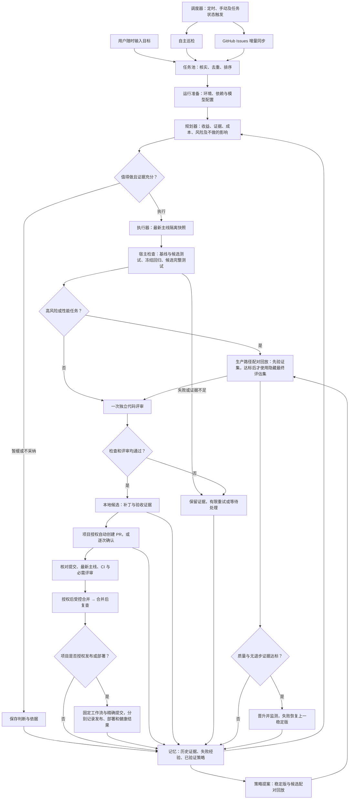

# 高级使用与配置

[返回项目首页](../README.md) | [English](advanced.en.md)

## 工作流程



调度器到期才扫描，已有任务按队列处理。交付默认保留本地候选，可按项目开启自动 PR 和自动合并。没有成功 CI、必需评审未满足、主线或候选变化时不会自动合并；不使用管理员绕过。发布和部署需要分别授权固定工作流，选择它们不会改变原有 PR、合并设置。合并检查、发布、部署和健康检查分别记录结果，工作流成功不等于已验证上线。策略演化是另一条受保护的实验闭环，不直接改写自身权限或验收标准。

## 代码质量门禁

实现者和评审者使用独立、权限不同的会话，可为评审者选择不同模型服务。评审必须逐项说明六个维度的判断，问题包含严重级别、文件、行号、影响及修改建议，结果可在任务详情查看。

默认阻断**中及以上**问题，可在设置中调整为高或低；致命和高等级始终阻断。任一维度不通过或证据不足，同样不能交付。即使模型一边说“通过”、一边列出阻断问题，宿主也会判定失败。失败记录进入后续重试上下文。

可维护性重点包括重复逻辑、无必要的抽象、复杂分支、模块耦合、命名与项目约定；评审应针对本次引入的问题，不强迫无关重构。将项目的 lint、类型检查、复杂度或依赖规则命令加入 `checks`，可与测试一起作为硬门禁；运行器不会擅自替项目选择全套静态分析工具。模型评审仍可能漏判，不能保证消除所有质量问题。

普通任务和策略回放都适用门禁。配对实验两边均执行评审；默认 3 个任务/集合、重复 2 次。只有独立样本足够且质量改进证据通过时才晋升，不把重复运行当作独立样本。调用、时间和 tokens 作为用量记录，不设实验金额额度；已知用量受 `evolution.max_cost_ratio` 的 token 比例规则约束。未知用量或零基线不推算比例，质量达标可晋升并明确标记成本不可比较。

## 先判断值不值得做

用户目标、自主巡检和 Issues 都必须经过同一个价值门禁。规划器先检查现状、是否重复或已修复，记录收益、影响、成本、信心、具体证据和不做的影响，再决定：

- **执行**：证据充分，收益与成本相称，并确定修改范围和验收标准。
- **暂缓**：需求不清楚、证据不足或当前优先级低。基线提交、任务证据或价值策略变化后重新评估，避免反复花费模型调用。
- **不采纳**：无实际收益的整理、成本不成比例或方向不符。保留理由，用户可手动重新考虑。

宿主会拦截低信心、缺乏有效证据或低影响高成本的执行建议。可在「运行设置」修改价值策略，在任务详情查看判断依据。模型判断仍可能失误，门禁不等于客观收益保证。

## 官方 API、中转站与本地模型

模型按角色选择，分为 Codex、OpenCode 和原生 API 三条执行路径：

| 协议 / 路径 | 适用服务 | 地址示例 |
| --- | --- | --- |
| OpenCode CLI | OpenCode 已配置的服务与 API/OAuth 登录 | 获取模型后选择 `provider/model` |
| Codex CLI | 默认 OpenAI/Codex、Codex 兼容中转 | 使用 Codex 认证或兼容 Responses 地址 |
| Responses | OpenAI 官方 API、兼容中转 | `https://api.openai.com/v1` |
| Chat Completions | DeepSeek、兼容的 Qwen/其他服务、中转站、LM Studio | `https://api.deepseek.com` |
| Anthropic Messages | Anthropic 官方 API、兼容中转 | `https://api.anthropic.com/v1` |
| Gemini GenerateContent | Google 官方 API、兼容中转 | `https://generativelanguage.googleapis.com/v1beta` |
| Ollama 原生 API | 本机工具调用模型 | `http://127.0.0.1:11434` |

原生 API 路径由宿主提供读取、搜索、编辑和隔离命令工具，不依赖 Codex CLI。规划与评审只有只读工具；实现才有写入和执行权限。模型必须支持相应协议的工具调用并返回规定的结构化结果，纯文本模型不能执行这些角色。**支持上述协议，不代表所有厂商、模型版本或中转站均已实测兼容**；非标准接口仍需适配器。

在 **「设置 → 模型设置」** 中管理「连接与模型」和「工作分工」。官方 API、中转站和本地服务可以添加多个独立连接；预设填写地址和协议，自定义服务可在高级设置调整协议。

1. 在「连接与模型」添加连接，填写名称、地址及 API Key，点击「保存并获取模型」。macOS 默认用系统钥匙串；Linux 默认使用权限为 0600 的本机私有文件，也可选会话内存或环境变量。界面保存的密钥立即用于目录和执行，无需重启；表单提交后清空，不存入浏览器本地存储，也不在 API 响应中返回。
2. 每个连接统一获取目录，可搜索、启用模型及添加自定义 ID。目录、更新时间和启用选择存入本机状态，刷新或重启后保留。刷新失败保留旧目录；从目录消失的模型标记失效，已有角色选择不被替换。地址、协议或密钥版本变化后，旧目录和测试结果失效。
3. 在「工作分工」直接下拉选择模型和思考深度，各项独立保存；模型按服务分组，也可点击「搜索模型」检索，再保存。目录明确提供推理强度时按支持项展示；未知时默认使用服务默认，Responses / Chat Completions / Codex 可在「高级参数」显式覆盖，也可配置备用模型。Anthropic、Gemini、Ollama 原生接口保持 `default`。默认规划/评审为 `gpt-6.1-sol / high`，实现为 `gpt-6-luna / max`。
4. 「项目设置」和「通用设置」分别提供入口，设置内也可切换范围；项目的目录启用选择和角色配置分别保存。「继承全局配置」保存后移除项目角色覆盖，后续跟随全局变化。已被角色或备用路由引用的供应商不能移除。

添加模型服务时，「高级连接设置」可实际修改协议、密钥保存方式和环境变量名，也可按行补充目录缺少的自定义模型 ID。保存后获取真实模型目录；获取失败会显示原因，不会伪造可用模型。目录未声明思考深度时仅提供服务默认或保留已配置值，兼容接口的显式覆盖仍放在角色「高级参数」中。切换认证方式后，隐藏字段不会阻断保存。

默认 Codex 登录通过 [App Server 的 `model/list`](https://developers.openai.com/codex/app-server#list-models-modellist) 读取目录；Responses、Chat Completions、Codex 兼容网关及 Anthropic 使用 `/models`，Gemini 使用 `/models` 并过滤明确不支持 `generateContent` 的条目，Ollama 使用 `/api/tags`，LM Studio 使用 `/v1/models`。支持分页，每次最多获取 1000 个条目；旧条目和自定义条目会保留。明确标记为图像、向量等非代码任务的模型不可启用；未知能力不会被猜测为已支持。

模型列表支持收藏、仅显示已启用、搜索及每页 20 条；角色选择器可按供应商筛选。高级参数中的备用供应商、模型和强度均可直接选择，角色草稿可撤销。每个角色显示当前草稿的继承来源、备用路由及当前强度的工具测试状态。

工具测试按推理强度保存结果与时间；同一强度失败会清除该强度的旧通过标记，不影响其他强度。认证、限流、连接、缺失模型及工具格式错误分别提示。连续三次认证、限流或连接故障后，暂停该项目范围内、同一连接版本的后续推理请求，重启仍保留；不会自动重试探测。检查配置后点击「检查后恢复请求」。代码检查及工具格式失败不计入供应商连续故障。目录查询仍可用于排查；更换连接版本会使用新的故障记录。已显式配置的备用路由仍受原交付与工作区保护约束。

可在模型「更多 → 估算价格」设置每百万 tokens 的 USD 输入、输出、缓存读取和缓存写入价格，以及兼容旧设置的混合单价。只对有用量的分项要求价格，分项不足时回退混合价；留空表示未知，显式 0 才代表免费。价格随每次调用冻结，后续改价不改写历史；未知用量不计价。估算不代表账单或金额硬上限。工作台与用量页使用相同计价规则，并标明未计价调用；没有项目但有全局模型测试记录时也可查看。

价格表单只提交本次改过的字段，清空字段会明确移除该价格。两个窗口修改不同分项时保留彼此的改动；同一字段仍按最后一次保存生效。目录与调用通过相同连接版本查价，轮换凭据不追溯更改已冻结的费用记录。

Anthropic 的 `max_output_tokens` 表示能力元数据，`request_output_tokens` 表示本次请求的保守输出预算。已识别的 Opus 4、Sonnet 4 使用 16384，Haiku 4 和 Claude 3 使用 8192，旧 Opus 别名、Claude 2 使用 4096；预算始终不超过能力上限。输出触及上限且 `finish` 结构仍无效时，最多给一次缩短修复机会，再以明确的输出限制错误结束并保留用量。此策略由离线协议夹具验证，真实供应商长输出成功率与成本仍需实测。

用量明细按运行和阶段展示 tokens、失败、额外调用与复用。历史参考只使用所选时间窗之前、同项目、任务来源类型、阶段、服务和模型的已完成调用；每项至少 8 个有效样本，最多取最近 200 个，展示每次调用 P25–P75，并声明样本和截断。样本不足或选择全部历史时不会编造参考，参考不等于任务费用预测。阶段内额外调用可能包括工具往返与重试，不能一概当作浪费。

独立用量页按当前浏览器时区显示每日柱状图和自定义日期范围，并按规划、实现、评审等角色分别汇总 tokens；后台检查和重试仍保留在任务统计中。时区只影响展示分组，不会改写调用时间或账单数据。

任务列表显示标题、状态和简短原因，详情保留规划收益、成本、证据与范围。工作台展开「用量与运行质量」可查看近 30 天有验收记录的运行通过验收和评审的比例、已评审运行的阻断比例，以及重复失败任务数；系统巡检不算作代码任务成功，统计不能作为能力提升的证明。模型状态会区分“连接已配置”“基础工具测试通过”和“真实任务已验证”；前两者不代表完整任务能力。真实联调方法见 [LIVE_VALIDATION.md](../LIVE_VALIDATION.md)。

获取目录不启动推理任务。可主动点击模型「更多 → 测试模型」，运行一次基本工具调用和结构化输出测试；弹窗说明可能计费，并记录实际 tokens。测试不发送项目代码，自动更新会等待测试结束。目录可见、基础工具通过与真实任务通过分别展示；基础测试不保证所有任务或推理强度可用。

```json
{
  "providers": [{"id":"gateway","name":"我的模型网关","protocol":"chat_completions","base_url":"https://models.example.com/v1","env_key":"RSI_MODEL_API_KEY"}],
  "models": {
    "implementation": {"provider":"gateway","model":"your-coder-model","effort":"default"},
    "review": {"provider":"openai","model":"gpt-6.1-sol","effort":"high"}
  }
}
```

上面的 JSON 示例使用环境变量：`env_key` 填**变量名**，不填密钥；更改服务进程的环境变量仍需重启。界面选择系统钥匙串或会话密钥时，配置只保存 `credential` 模式和随机 `secret_ref` 引用；会话密钥重启后需重新填写。钥匙串按本地状态目录区分存储，原始密钥不写入配置、数据库、事件或命令参数。原生接口密钥仅在请求层使用，命令工具和项目检查不继承；Codex 兼容路由通过专用进程环境变量读取。远端要求 HTTPS，本机回环允许 HTTP。无认证本地服务可选择「无需密钥」。供应商列表整体覆盖，ID 不可重复；旧配置未指定 `protocol` 时保留 Codex 路径。

高级配置可显式指定跨服务备用路由：

```json
{"models":{"implementation":{"fallback":{"provider":"ollama","model":"your-local-coder","effort":"default"}}}}
```

仅服务/模型不可用、限流等错误触发备用路由；原生实现工具已经修改工作区后，不再切换实现以免混入半成品。检查或代码评审失败不会靠换模型绕过。调用记录包含服务、模型、强度、用量；修改模型、服务地址或评审规则会使旧策略验证证据失配。

**用量只记录，不设额度**：Codex 和 OpenCode 按 CLI 会话统计，原生接口按 HTTP 请求统计。记录输入、输出及可获得的缓存 tokens，缺少用量时标为未知；费用仅作估算。旧配置中的每日/每轮调用、任务总时长、改动文件数及实验调用额度不再生效。`limits.command_seconds` 仍是安全超时（60–86400 秒）。暂停、取消、连接超时和异常恢复继续有效。

协议参考：[Responses 工具调用](https://developers.openai.com/api/docs/guides/function-calling)、[Anthropic 工具调用](https://platform.claude.com/docs/en/agents-and-tools/tool-use/overview)、[Gemini 函数调用](https://ai.google.dev/gemini-api/docs/function-calling)。本地协议替身测试通过，真实厂商调用尚待验证。

## OpenCode

在模型设置的「连接与模型」选择内置 **OpenCode**，先选择供应商，再使用其支持的官方登录或 API 密钥。登录成功后刷新目录，在工作分工选择模型及支持的 variant。连接使用**运行机器**上的认证和全局供应商配置，不读取另一台电脑的登录。也可使用 `opencode auth login`；自定义连接支持全局 JSON/JSONC 配置的 `provider` 字段及其显式环境变量。不会导入项目插件、MCP、Agent 权限或自定义指令。服务器可使用执行镜像中的 CLI。已验证版本为 OpenCode 1.19.3 和 2.1.3；2.x 使用 `provider/model#variant`，1.x 使用 `--variant`。

内置 **Codex 登录** 支持在页面发起官方设备授权：打开官方页面，输入一次性验证码，完成后自动更新连接状态与模型目录。账号或工作区须允许设备授权；没有权限时可连接 API 服务。支持取消、退出和重新登录。授权凭据保存在运行机器，重启后仍可使用；未完成的授权在服务重启后标为中断，需要重新发起。登录只刷新模型目录，不自动执行付费能力测试。详细操作见 [账号连接](accounts.md)。

OAuth 运行中刷新后仅写回该连接原有字段，保留其他连接；执行日志脱敏，临时 HOME 随任务调用清除。CLI 工具用量以输出事件实际报告为准，未报告的辅助调用不能推算。

## 启动

macOS 双击 `启动 Adaptive RSI.command`，或在本目录执行：

```sh
python3 scripts/start.py
```

启动器会复用现有服务；关闭浏览器不停止调度。电脑休眠时工作暂停，恢复后合并遗漏触发。关闭服务可对 `server.json` 中的本服务 PID 发送 SIGTERM，或使用前台模式按 Ctrl+C：

```sh
python3 -m adaptive_rsi serve --open
python3 scripts/rsi doctor
```

在控制台「添加项目」粘贴 **GitHub 链接**，每行填写一个仓库地址；也可切换为**本地 Git 仓库**。GitHub 导入使用已登录的 `gh`，每个仓库单独克隆并默认暂停；本地仓库须已有提交。检查设置后再启用，无需先输入目标。

日常操作集中在「工作台」：侧栏切换项目，页面直接查看进行中、需要你处理和历史任务，并支持分页与后台检查筛选。首次接入项目并选好模型后，点击「开始运行」即可，无需先填写目标。顶部直接进入「项目设置」，侧栏底部进入「通用设置」；用量、活动及自我改进记录按需查看。任务详情在桌面侧栏、手机全屏展示，先看结果、检查与评审状态、代码位置和后续操作，再展开证据与历史运行。

工作台的「调整扫描时间」进入项目扫描设置。只保留**项目检查**与 **GitHub 问题同步**，默认均为每小时；项目检查涵盖 bug、功能缺口、性能、体验及维护改进，并轮换深入检查模块。发现数量不设上限；Issues 按页同步全部匹配条目、逐页保存进度。两类均支持自定义时间、暂停及跟随通用设置，保存后立即生效。正在运行的同类检查不会重复启动。

日常运行设置展示任务来源、扫描间隔、交付方式和固定检查。固定检查按名称、项目内目录和独立参数输入框编辑，首项是程序；每项内的空格与换行原样保留，不使用 shell 引号或拼接。留空时自动识别，缺少可执行检查会阻塞交付。命令不写入浏览器持久草稿。技术参数、实验和更新放在「更多运行选项」；已废弃额度和任意 JSON 覆盖不再显示，已有兼容配置保留。多项目的模型、草稿和交付授权分别保存。

保存栏持续标明未保存、保存中或已保存，并注明范围和保存时间。扫描时间保存后重新安排；运行中任务保留开始时的配置快照。模型分工使用自己的保存按钮，从新任务生效。交付授权在执行前按当前项目设置复核，无需重启。保存失败时输入和未保存状态保留。

任务结果按检查展示名称、通过状态、退出码和可展开的原始输出，涵盖基线、冻结回归、候选全量和独立验收；独立验收仍显示修改前后对照。错误先给可操作说明，再展开原始诊断。手机和桌面的批准确认均显示项目、仓库、分支、检查基线、验收与评审证据及当前交付授权。批准为本次候选排队交付，并明确展示后续自动合并、发布与部署：只有本次运行与当前策略同时允许时才能执行，发布和部署还要求工作流授权完全一致。远端基线和 GitHub 门禁在执行前复核，暂停项目不会立即推送。

工作台同时展示控制台连接、运行准备状态、阻塞或失败任务数、当前已载入运行中的近期故障，以及各角色已配置、基础工具测试和真实任务验证的证据。未知状态不会显示为成功；目录获取和运行准备检查不会启动付费模型测试。

接入项目、供应商与密钥、模型分工、巡检间隔和交付设置均在保存后生效，无需重启服务。正在执行的任务保留已封存配置，新任务读取新设置。只有安装运行器新版本才在后台重启；页面遇到安装窗口会保留表单并自动等待，恢复后继续提交，最多等待两分钟。提交后断线不会自动重复提交，避免重复执行。

界面默认中文，可在顶部切换 English，并在当前浏览器中记住选择。用户目标、模型输出、原始日志和证据保留原文；CLI 命令与配置字段保持英文。

状态默认存放于 `~/.local/share/adaptive-rsi`，可通过 `ADAPTIVE_RSI_HOME` 或 CLI 的 `--state-dir` 指定独立目录。状态应位于受管项目目录树之外。控制台只监听 `127.0.0.1`，登录链接含本地会话令牌，不要分享；服务启动后可用 `python3 scripts/rsi open` 再次打开。

### 日常使用说明

- 已有项目时，设置默认修改当前项目；通用默认仅供没有单独设置的项目沿用。交付授权只能按项目设置，通用页提供切换入口。
- 交付可选「先保存，暂不提交」「自动提交修改，等待合并」「检查通过后自动合并」。PR 是 GitHub 上的修改申请；选择自动合并也不能跳过价值判断、测试、独立评审或仓库保护。
- 界面改用自动检查、模型服务、思考深度等日常表达，保留 `high`、`max` 等实际参数。基础能力测试会真实调用模型，可能收费，只验证基础工具调用与输出格式，不等于真实任务能力认证。
- 表单报错时保留输入，重复点击不重复添加目标；批量接入部分失败时，仅保留未成功链接供重试。后台刷新不再关闭未变化的活动详情或重建任务列表。
- 浏览器会话失效时，按页面说明重新打开，或运行 `python3 scripts/rsi open`；项目与设置不会丢失，无需重启。不要分享含登录凭据的链接。

## 已实现的闭环

- **调度**：项目检查与 Issues 增量同步均默认 60 分钟，无独立深巡检计划。项目检查逐步轮换模块；已检查范围及相关证据没有变化时可跳过模型调用。发现的问题全部校验、去重、入队，再评估价值和执行。开机恢复合并遗漏触发，不回放每次定时。
- **模型**：理解、规划、审查和改进提案使用 `gpt-6.1-sol / high`；实现使用 `gpt-6-luna / max`。按所选协议实际路由。备用模型必须显式配置，调用失败会记录。不会自动付费探测；可在模型中心主动测试，真实项目能力仍由任务验收确定。
- **三种任务来源**：自主发现需要现有源码的可核实引用；用户目标可以随时入队；Issues 支持标签过滤、更新时间游标、重复去除、关闭检查及已有 PR 上下文。规划时按需加载最近 Issue 评论作为不可信上下文；权限或分页问题会明确提示缺少评论证据。Issue 内容不授予权限。
- **隔离与验证**：每轮从固定 Git 提交生成独立克隆，不写入用户工作目录。实现与审查分开会话；宿主固定验收命令，在独立目录重跑基线与候选。原有测试与构建入口由基线覆盖，并在检查进程中禁止写入。模型的成功文本不是验收结果。缺少检查、零测试或证据不足不会放行。
- **状态与用量**：单服务锁、项目锁、原子任务领取、配置快照、调用与输入/输出/缓存 tokens、时长和估算费用记录。没有调用、任务时长、文件数量或 tokens 配额；暂停、取消、异常恢复及有界日志处理仍保留。
- **交付**：默认本地候选；项目设置可选择「通过门禁后自动创建 PR」及「授权此项目通过检查后自动合并」。每次运行保存授权快照，交付时再次检查当前授权，暂停或撤销后阻止后续尚未发出的推送、PR 创建与自动合并。已发出的远端请求不能撤回。全局设置和任务覆盖不能授予交付权限。旧版遗留授权仅撤销一次，之后明确保存的项目策略在重启后保留。
- **主线**：关联 GitHub 的项目每轮在独立缓存拉取配置分支（留空为默认分支），不依赖本地 checkout 是否更新。候选和评估均固定同一 SHA；主线变化时旧 PR 停止交付，有限重新规划。原工作区和未提交文件不被改写。
- **多项目公平性**：持久化加权轮转并考虑等待时间；项目权重 1–10，默认 1。所有启用项目先更新定时任务，再按全局并发限制派发，各项目始终最多一轮在执行。
- **收益反馈**：记录合并 SHA，并在合并后及主线再次变化后复查（默认每天，最短 5 分钟）。通过、回归、证据不足及回退分开记录，进入后续价值评估；巡检报告复发时重新评估，模型报告不当作已验证回归。原始检查日志保留在任务详情；调查任务仅携带有界摘要，入队失败会重试而不丢失已完成的反馈。观察窗口沿用产物保留期，默认 30 天；监控结束后，运行工件（含历次合并后验证快照）随保留期统一回收，回收可按收据撤销。
- **策略演化**：执行策略、元策略和适配指导是可演化的检索指令。候选不会修改控制器、权限、用量记录或评估器。候选在验证集和隐藏最终评估集上分别与稳定版配对运行；质量改善、无已观察退步且独立样本证据足够才能晋升。初期任务失败会恢复上一稳定版并使对应技能失效。观察、验证后的技能、失败候选分开保存。

## 环境与实际边界

支持 **macOS Seatbelt** 与 **Linux Docker**。Codex、OpenCode CLI 在 Linux 的独立容器中执行，仅挂载本次快照和独立 HOME，不挂载 Docker socket、控制器、其他项目或评估样本；规划与评审的源代码只读，Git 元数据只读。CLI 可联网访问模型服务，OpenCode 只导入所选连接的 API/OAuth 配置，不继承项目插件或 MCP；CLI 的必要凭据位于本次独立 HOME。确定性检查和原生 API 的命令工具使用无网络容器。Windows 宿主暂不支持。镜像需预先构建，语言工具链可通过自定义镜像提供。

适配器覆盖 Java/Kotlin（Maven、Gradle）、JS/TS（npm、pnpm、Yarn）、Python、Go、Rust、C/C++、.NET、PHP、Ruby、Swift/Objective-C、Dart/Flutter，并扫描 SQL、Shell、PowerShell、HTML/CSS、Docker 和 CI。状态分为**待验证、可分析、环境阻塞**。Xcode、Make 等需要项目特定命令；依赖未缓存的项目需要先准备环境。识别到语言不代表该语言的全部项目都已验证可执行。

当前验收以项目的固定检查为依据。项目没有合适测试时，应在设置中明确配置；不能把模型审查当作测试。固定测试、不同会话和操作系统沙箱降低篡改风险，但不构成抵御任意恶意代码的正式安全证明。模型认证和网络连接由所选执行路径处理；代码上下文会发往你选择的模型服务，其数据政策由对应服务决定。本地控制台、日志和经验不会被运行器自行公开上传。

长期递归提升需要真实任务和持续实验，当前产品不声称已经证明这种提升。没有受保护评估集时，可以提出和存档候选，**不能自动晋升**。采用周期调度与手动触发；Linux 可通过专用安装器配置 systemd 开机服务。浏览器控制台独立于 Codex 原生设置页。

## 配置与 CLI

配置优先级：**单任务覆盖 > 项目覆盖 > 全局默认**。活动任务保留开始时的配置。可视化页面覆盖常用参数，高级 JSON 和 CLI 支持完整配置。

```sh
python3 scripts/rsi add /path/to/repository
python3 scripts/rsi import https://github.com/owner/project-a https://github.com/owner/project-b
python3 scripts/rsi status
python3 scripts/rsi resume PROJECT_ID
python3 scripts/rsi goal PROJECT_ID '修复分页边界并补回归测试'
python3 scripts/rsi inspect PROJECT_ID --deep
python3 scripts/rsi issues PROJECT_ID
python3 scripts/rsi pause PROJECT_ID
python3 scripts/rsi config --project PROJECT_ID --json '{"schedule":{"light_minutes":240},"sources":{"inspection":true}}'
python3 scripts/rsi goal PROJECT_ID '改进错误处理'
python3 scripts/rsi deliver RUN_ID
python3 scripts/rsi retry TASK_ID
python3 scripts/rsi rollback CANDIDATE_ID
python3 scripts/rsi update check
python3 scripts/rsi update apply --confirm
```

固定验收命令使用 argv 数组，不使用 shell 拼接：

```json
{"checks":[{"name":"unit regression","cwd":".","argv":["python3","-m","unittest","discover","-s","tests","-v"]}]}
```

依赖可通过可信的预制容器镜像准备，也可显式选择项目内未跟踪的依赖目录做只读来源快照。实现副本和验收副本分别复制，验收会恢复同一份冻结依赖；不会改变原目录。示例：

```json
{"environment":{"seed_paths":["node_modules"],"max_seed_mb":1024,"setup":[]}}
```

`setup` 可放置需要在隔离环境中执行的离线依赖准备命令，格式与 `checks` 相同。外部符号链接、缺失依赖或准备失败会明确阻塞。连接全局 store 的 pnpm 目录、指向宿主的虚拟环境可能需要改用独立镜像；运行器不会为了兼容而开放整个用户目录。

## 多项目隔离

多个 GitHub 链接分别建立项目 ID、独立克隆、任务池、Issue 游标、配置、用量、运行证据、记忆与策略。默认导入目录是状态目录旁的 `adaptive-rsi-projects/owner--repo`。相同仓库重复导入返回已有项目，不混入另一个项目。

控制台顶部切换项目；全局默认与全局并行数共享，项目覆盖独立。拒绝目录嵌套；模型及检查进程不能读取其他已注册项目，命令工具不继承服务密钥。注册新项目需要等待活动任务结束，确保现有进程的隔离边界一致。所有项目仍由同一个本地服务账号管理，这是单用户隔离，不是多租户服务。

## 用户版本更新

在通用设置「软件版本更新」选择手动、发现新版提醒（默认每日检查）或空闲时自动更新。自动模式可选择仅补丁、同一主版本内更新或全部稳定版本，默认仅补丁。只安装符合更新包及状态格式要求的正式版本，任务和账号授权进行时等待空闲。

更新器只从本仓库 GitHub Releases 获取正式 ZIP 和 SHA-256，检查包结构、版本及状态格式，安装到状态目录内的独立版本目录，备份数据库，重启并检查健康状态。新服务启动失败时恢复旧代码和数据库。配置、项目记录和历史保留；源码工作目录不会执行 `git pull`。校验和用于完整性检查，尚无独立发布签名。

这是运行器更新。Codex 已加载的插件技能/元数据仍需刷新 marketplace 并重启 Codex；长期安装可将本地 marketplace 指向 `~/.local/share/adaptive-rsi/installations/current`，首次托管更新成功后该路径才存在。现有 wheel 的命令入口不会因此自动替换，请使用随插件提供的 `scripts/rsi` / `scripts/start.py` 或更新 pip 包。更新机制已本地验证；**维护者发布合规 Release 资产之后，用户才会收到新版**。断电及整个监督进程崩溃不属于已验证的自动恢复范围。

维护者发布步骤见 [RELEASING.md](../RELEASING.md)。

## 独立评估任务

真实历史修复或隔离环境中的合成缺陷均可导入。清单示例：

```json
{
  "family": "pagination-empty-last-page",
  "split": "holdout",
  "source": "real",
  "repository": "/path/to/evaluation-fixture",
  "base": "COMMIT_SHA",
  "task": "修复空末页时的总数与页码计算。",
  "checks": [{"name":"acceptance","cwd":".","argv":["python3","-m","unittest","discover","-s","tests","-v"]}],
  "overlay": "/path/to/protected-tests"
}
```

```sh
python3 scripts/rsi import-case PROJECT_ID case.json
python3 scripts/rsi evolve PROJECT_ID
```

`split` 为 `development`、`validation`、`holdout`。同一家族或同一任务快照不能跨集合；近重复缺陷仍需整理者正确标注家族。默认验证集和最终评估集各至少 3 个家族，最多曝光 3 次。overlay 由控制器保存，仅在独立评估时写入测试目录，不交给候选。合成缺陷只存在于评估副本，不会进入真实项目任务池。这里没有把自动生成的合成任务冒充真实业务证据。

## Codex 插件

根目录 `plugin.json` 使用 Agent Plugins 1.0 manifest；`.agents/plugins/marketplace.json` 提供本地目录条目，技能位于 `skills/`。可通过支持本地 marketplace 的 Codex 插件目录添加此项目；安装后运行 setup。不同客户端的目录重载/安装界面可能不同，未自动修改你的个人插件目录。也可直接使用上述启动器，无需先安装插件。

## 验证开发版本

```sh
python3 -m unittest discover -v
node --check adaptive_rsi/web/app.js
node --check adaptive_rsi/web/i18n.js
```

上述自动化测试替代模型接口，真实执行 Git 快照、SQLite 竞争控制、macOS 沙箱、原生协议工具往返、回归测试和服务升级/失败回退；不消耗模型调用或写入 GitHub。浏览器验收检查桌面/移动布局与设置保存。另已在独立 Python 测试项目完成两轮真实模型、远端 CI、PR 自动合并及合并后复查；其他供应商、语言和长期运行仍需对应场景验证。

本次验证范围与未验证事项见 [VALIDATION.md](../VALIDATION.md)。

欢迎提交 Issue 或 PR，详见[贡献指南](../CONTRIBUTING.md)。本仓库提交说明使用中文。

## 自主交付闭环

行为、配置和界面修改由实现者新增一个单独的回归测试文件；宿主构造针对该文件的测试命令，在原始基线和候选中分别隔离运行，并要求前者非零退出、后者通过，不再从整套测试日志中推断失败属于哪个文件。不得修改既有测试、测试配置、清单或检查入口；测试文件未被运行器发现、无法构造隔离命令或基线失败来自环境问题时，任务以证据不足阻止交付。配置的运行器若不支持隔离调用，则回退到实现前封存的独立验收。既有测试仍由基线冻结副本保护，候选完整测试会执行新增测试。冻结回归与候选完整测试若使用相同测试树和命令，共用一次候选运行；测试框架变化或外部验收覆盖层时分别运行。

高风险和性能任务始终在实现前额外设计独立验收并封存，验收逐条覆盖计划标准；若普通行为、配置或界面任务所用测试器不支持隔离运行新增测试，也使用同一独立验收回退路径。文档修改与重构只需通过适用的固定回归并由评审确认范围和维护收益。独立代码评审检查六个维度；只有评审证据不足或改动实际涉及认证/凭据、安全边界、沙箱、迁移/数据库、依赖清单、发布/部署工作流或核心运行时路径时，才启动额外专项评审。模型判断仍需固定检查和真实任务验证支持。

运行开始时封存仓库、解析后的目标分支和 SHA；更换目标不能沿用旧候选的授权，过期候选会在重试上限内重新规划。PR 使用 `feat/rsi-*` 或 `fix/rsi-*`，提交和 PR 说明使用中文。只有精确候选提交的 CI 成功、GitHub 报告可合并且必需评审通过才请求 squash 合并；GitHub 分支规则仍是最终约束。推荐对主线启用严格必需检查（或合并队列），避免主线在检查与合并请求之间变化的竞态。检查失败保留 PR；主线变化关闭过期 PR 并在重试上限内重新规划。重启恢复 PR 跟踪和幂等发布，不重用被中断实现的未验收产物。

Codex CLI 需要支持命名 `permissions` 配置；macOS 下使用 Codex 自身的一层 Seatbelt，工具默认不可读取项目快照和系统工具链之外的文件，包括未注册项目的用户文件、控制器、其他项目、Codex 认证或 GitHub 凭据，不可写 `.git`，禁止工具网络访问。不会通过关闭隔离来适配旧版 CLI；不支持时明确阻塞。真实联调证据见 [LIVE_VALIDATION.md](../LIVE_VALIDATION.md)。

## 桌面版

支持打包的本机运行器、菜单栏驻留、手动开始项目、服务器连接和按任务统计用量。正式版本提供 macOS ARM64 DMG；临时签名尚未 Apple 公证，使用限制、生命周期及平台边界见 [桌面版说明](../DESKTOP.md)。

桌面菜单提供打开主窗口、检查更新和导出诊断包，快捷键为 `⌘⇧O`、`⌘⇧U`、`⌘⇧D`，不会占用文本编辑的常规快捷键。更新面板分别显示下载速度、签名校验和替换阶段；总大小未知时不显示百分比。应用内自动更新会把已下载分段保存在缓存目录，并与版本及下载地址绑定，重启后按已有字节续传，不会把新版本追加到旧分段；服务器不支持续传时重新下载，已完整但尚未落盘的分段在 416 响应下先校验复用，校验失败的分段会被删除。系统或架构不匹配的更新包在下载前拒绝，当前版本保持可用。安装前会再次查询更新源；更新源无法访问而安装已被批准时，暂存包仍可继续安装，替换前会重新对安装字节做签名校验。退出时先显示关闭阶段、剩余任务和后台操作，服务安全停止后再退出应用。诊断包默认只含版本、数量、故障代码和占用，导出前必须预览并勾选确认；不含凭据、路径、代码或任务正文。

## 存储诊断与归档验证

成功的控制台状态轮询每条路由每分钟最多记录一条请求日志；错误响应及写请求仍逐条记录。诊断中的 `database.request_logging` 显示本进程观察、落库、采样省略和落库失败的计数。请求日志只含路径，不含查询参数、请求正文或认证头。采样省略的请求 ID 不提供持久化检索。

WAL 维护只执行不等待读者的 `PASSIVE` 检查点。诊断中的 `wal` 显示本进程读快照数量、最长持续时间、上次检查点的剩余页数和时间；其他进程的读事务不能从本进程快照数推断。持续存在的读者可使 WAL 保留，维护不会强制中断读取。

可用下列命令导出和验证私有数据库归档；压缩级别为 0–9，默认 6。超时或取消时不发布未完成的归档。

```sh
adaptive-rsi --state-dir /PATH/TO/STATE archive --compression 6 --timeout 300 --max-mb 1024
adaptive-rsi verify-archive /PATH/TO/STATE/archives/ARCHIVE.sqlite3.gz --timeout 60
```

归档旁的 `.manifest.json` 记录压缩文件和源数据库的 SHA-256、字节数及数据库范围。验证在临时目录有界解压，校验两份摘要、SQLite 完整性和关系；不会连接恢复出的项目或派发远端工作。归档只包含数据库，不包含源码、运行产物或外部凭据。校验清单用于发现损坏，不构成签名或来源证明。旧归档缺少清单时会明确失败；不会被自动删除。每次维护最多校验一个到期归档，同一归档默认每七天复查。

原生模型故障保留标准化停止原因，包括输出上限、安全策略、拒绝、暂停和没有工具调用。界面提供对应中英文指引。供应商响应头中的请求 ID 通过固定头名及字符长度白名单保留到调用事件或错误诊断；认证头、Cookie 和完整响应头不进入这些记录。

数据库损坏或原目录不可写、正常服务无法启动时，可运行离线诊断，不必先初始化 `Store`：

```sh
adaptive-rsi recover-diagnostics /PATH/TO/STATE/state.sqlite3 --timeout 10 --max-mb 1024
```

诊断只读打开原数据库及已有 WAL，把它们复制到临时目录，再对副本执行检查，不创建原目录的 SHM 或其他文件。输出包含摘要、大小、表计数及结构化错误，不包含配置值、任务正文或坏页原文。它不是可直接覆盖原库的修复工具；复制期间源文件变化时会标记 `consistent_source: false`，应停止运行器后重新检查。损坏页面可能使部分计数不可用，超时和空间不足会明确退出。

多项目调度按最近 24 小时已结束运行的工作线程占用秒数除以项目权重选择。每次运行最低记为一秒，避免极短任务的时钟噪声改变公平性；这不是 CPU 时间或模型费用。持续具备运行资格且等待一小时的项目优先于资源债务比较，但仍须满足项目暂停、依赖、工作时段和并发约束。实际占用和等待依据保存在 `fair-accounting` 中，可用于核对调度选择。

数据库兼容格式仍为 v2。后续维护迁移按实际 SQL 字节保存 SHA-256，并在执行迁移前验证已应用历史；迁移正文变化、未知历史版本或版本缺口会阻止普通启动，原库可用离线诊断检查。SQL 变更与迁移记录同事务提交。原有 1/2 号迁移保留旧标识符校验和，不能据此追溯验证旧引导正文；封存后不再每次启动重复全量回填。该机制没有把旧引导中的事务外建表追溯改成原子迁移。

部署健康策略：`delivery.deploy.health_attempts` 为总轮数（1–10），`health_consecutive_successes` 为要求连续成功轮数（1–总轮数，默认 1），`health_interval_seconds` 为轮次间隔（1–300 秒），`health_warmup_seconds` 为预热（0–900 秒）。`health_url` 是主端点，`health_urls` 最多增加 7 个不同 HTTPS 地址，不允许账号、查询参数或片段。每一轮共享 15 秒总时限，所有端点必须确认目标完整 SHA；失败会清零连续成功计数，耗尽轮数也未满足连续成功要求时判为健康门禁失败。观察记录持久化，重启继续，回滚同样适用。一次健康采样成功不等于连续观察门禁通过。

数据迁移回滚保护：`delivery.deploy.rollback_data_policy` 默认 `manual`，包括升级前没有该字段的配置；仅 `backward_compatible` 表示维护者确认旧程序可以读取已迁移数据。即使开启 `automatic_rollback`，未明确兼容仍会阻止新派发旧版本。`rollback_recovery_notes` 可保存最多 2000 字符的人工恢复步骤；失败详情会显示这些原始说明。请描述数据库备份位置、迁移逆向步骤和兼容程序版本，不要填入凭据。该声明不能代替真实迁移兼容验证；已在远端派发的回滚仍继续核对结果，系统不会假装撤回已发生的副作用。

执行资源排队：模型调用优先级为 10，普通命令为 20，独占性能评估为 30，数值较小者优先，同级 FIFO。等待至少 30 秒的请求进入按先后顺序优先处理的队列，避免持续出现的新请求无限超越旧请求；这不意味着能抢占已执行的任务，也不承诺阻塞内核调用的结束时间。独占评估只有在既有共享执行退出后进入。诊断导出包含最近 256 次排队结束样本（包括取消）、nearest-rank p95、等待数、最老等待时长和最近 64 条仅含序号/优先级/耗时/结果的回执。取消不会保留队列占位。

资源压力准入：`limits.min_free_disk_mb` 和 `limits.min_available_memory_mb` 为可配置的 MiB 下限，范围 0–1048576；默认 0，表示关闭，不影响旧配置。磁盘分别检查状态目录和项目目录；任一个低于门槛或启用后读数不可用时，调度器不领取新任务，任务保持排队、不增加重试次数。其他资源满足条件的项目仍可运行，下一轮调度观察到资源恢复后自动继续。运行中的任务不会被该门禁终止。这是领取时的低水位观察，不预留资源，也不能保证后续外部程序不会消耗资源。内存读数最多缓存 5 秒；macOS 根据 vm_stat 的 free/inactive/speculative 页给出可回收估计，Linux 使用 MemAvailable 并受可见 cgroup v2 内存上限约束，不代表所有容器控制器都可见。启用门槛而平台无法测量时保持等待。API 提供采样时间、依据、门槛和原因；队列显示资源压力等待，设置门槛变化后不会继续套用旧门槛报告。
